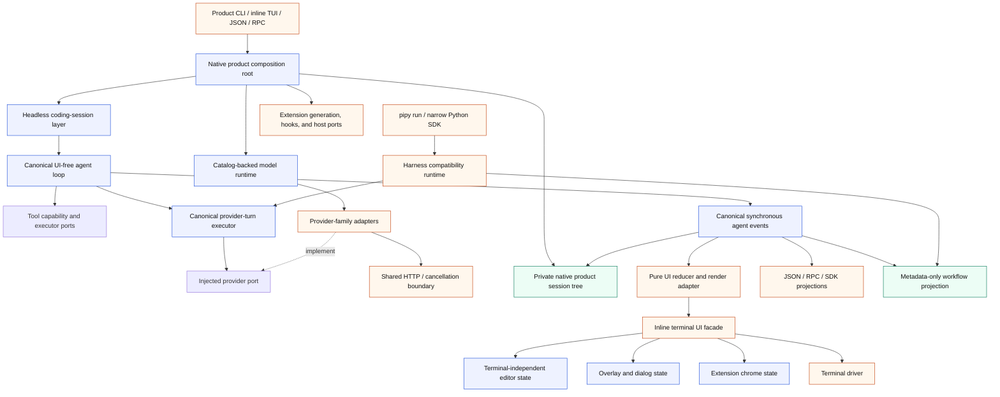

# Pipy Architecture

Status: living overview of the current native coding-agent product.

Pipy is a Python coding-agent application. Its primary path is the native
interactive product (`pipy` / `pipy repl`), not a wrapper around another agent
CLI. `pipy_harness` owns the agent runtime, providers, tools, private product
sessions, automation modes, extensions, and terminal UI. `pipy_session` is a
separate metadata-only workflow archive and catalog.

Historical architecture-quality measurements, review evidence, and migration
disposition are preserved in the retained
[2026-07-29 architecture quality assessment](2026-07-29-architecture-quality-assessment.md).
Completed program execution plans are recoverable through Git history; they are
not dependencies of this overview.

The native product runtime, headless coding-session layer and separate workflow
archive are established. Pipy's source repository is public. The
[backlog](backlog.md) selects current work and owns direction, task dependencies
and dispatch; this overview owns the current runtime structure and dependency
boundaries. Completed refactoring programs and older proposed priorities do
not define another active queue. See [Quickstart](quickstart.md) for current
checkout installation and [Export and Distribution](export-distribution.md)
for that surface's contract and limits.

## Runtime structure



The core is synchronous. Provider and tool work may use owned workers so a TTY
or RPC caller can cancel or inject input, but no asyncio loop owns the product
lifecycle. Canonical events use synchronous push semantics: each mode's fixed
composite accepts its ordered projections before the producer advances.

## Canonical agent layer

`src/pipy_harness/native/agent/` is the reusable, provider-neutral core. It
owns immutable full-content messages and events, active-input identity,
request-local tool authorization, usage accounting, history reduction, one
provider-turn execution, one tool-call execution, and the single accepted-run
`AgentLoop`. The loop runs against fake provider/tool/event ports without a
terminal, product session, extension implementation, concrete transport, or
workflow archive.

Product adapters in `native/agent_request.py`, `agent_loop_policy.py`,
`agent_runtime.py`, `agent_adapters.py`, and `tool_capabilities.py` bind that
core to catalog selections, extension policy, current product state, concrete
tools, rendering, and persistence. These adapters are composition seams; the
canonical package does not import them back.

`native/tools/base.py` holds the one tool model for built-in, extension and
MCP tools. A `ToolDefinition` carries, besides what a request declares, the
metadata that decides how a tool is reached (`exposure`, `namespace`,
`annotations`, `output_schema`, `reaches_tools`) and a `schema_mode`. Strict
definitions keep pipy's JSON-schema subset. Foreign definitions carry a schema
pipy did not write and are validated at call time by
`native/tools/foreign_schema.py`, a standard-library validator for a named
keyword set, so the runtime needs no JSON Schema dependency. The frozen
provider-request snapshot keeps only the model-visible part of a definition
(name, description, input schema, `schema_mode`); the metadata stays on the
registered definition. `structured_content` on `ToolExecutionResult` and
`AgentToolResultMessage` is in-memory state for programmatic callers: it takes
no part in history equality, no provider adapter reads it and the session file
does not store it, matching Pi, whose stored `ToolResultMessage` has no
`structuredContent`.

## Headless coding-session layer

`src/pipy_harness/native/coding/` owns product policy above a single agent run:

- `input_queue.py` owns command precedence and steering/follow-up/trigger
  ordering;
- `state.py` owns the active provider/model labels, canonical history, usage,
  counters, compaction state, and separate provider/preparation-failure state;
- `accepted_input.py` prepares one accepted prompt and request-only context;
- `agent_run.py` assembles and invokes the canonical loop;
- `request_budget.py` supplies pure numeric request estimates and declared/explicit
  limit resolution; existing REPL request/compaction owners compose live admission
  while settings/catalog retain their own guards and metadata ownership;
- `status_effects.py` owns the run-entry, input-accepted, result, cancellation,
  tool-policy, preparation-refusal, provider-settlement, no-tool, and
  malformed-fatal status family behind narrow state and presentation ports;
- `commands.py` and `command_registry.py` own the closed command vocabulary,
  classification, metadata, and dispatch outcomes;
- `product_session.py` coordinates state-first private-session transitions; and
- `session_controller.py` owns input selection, command/resource/extension
  precedence, true-idle settlement, and the outer session lifecycle. Its internal
  persistent lifetime drives the same loop as the stream entrypoint, yielding
  explicitly at idle without repeating startup or disposing the session.

This package is headless: terminal rendering, extension implementation,
provider construction, concrete tools, filesystem persistence, automation, and
the metadata archive are injected or remain outside it. Request accounting uses
canonical immutable messages/tool schemas and an extracted image count; it does
not import the attachment loader or concrete read tool. Catalog/configuration
owners carry context-window provenance, including unknown defaults and fallback
rows. An exact direct-import allowlist and fresh-process dependency check pin
the helper's separation from settings, catalog selection and image loading.
See the [budget contract](harness-spec.md#model-aware-request-budget-contract)
for the implemented heuristic, live integration and durable-origin boundary.

Canonical request preparation now returns exactly one frozen request, cancellation
or typed recoverable failure. Refusal stops only the accepted agent run, retaining
normal turn/run completion and queue handoff without admitting an assistant
message or fabricating a provider result. The existing coding state guards every
preparation-failure reader and writer; publication requires its installed live run
witness. Accepted-input reset and context replacement clear the field, while
same-context history publication and compaction retain it. Status effects publish
before pending-input promotion, diagnostics and presentation, with callbacks
outside the state mutex. Frozen product snapshots preserve the full failure;
bounded results and archive metadata expose only `request_preparation_refused`.
Live budget admission remains a later integration of these existing owners.

## Product composition and one-shot runtime

`CodingSessionAdapter` in `adapters/native.py` owns reusable product preparation:
`prepare_session_context` resolves the injected provider, settings/trust, prompt,
instructions and skills; `build_session` constructs the configured
native session from those private values. The same settings instance reaches
preparation and wiring. Neither helper starts a lifetime or emits workflow archive
events. The stream adapter retains its context event between preparation and
construction, including the existing failure order. These internal methods do
not change the direct adapter's empty instruction-loader default or expose a new
public SDK.

`native/coding/session.py` is the interactive product composition root. Its
internal `_open_lifetime` context keeps the prepared wiring and startup-candidate
scope alive across repeated queue submissions through the prepared adapter and
`open_session_lifetime` composition function in `repl/wiring.py`. The facade
retains its single explicit wiring-input mapping. Stream `run` and persistent
driving share the controller-owned loop and cleanup. The internal handle is
not a public SDK; `product_api.py` supplies supported construction and thread-entry
controls over it.

The composition root constructs settings and trust state, catalog-backed providers, tools,
extensions, the private session tree, event projections, automation or terminal
input, and the headless coding/agent collaborators. Dynamic command effects and
cross-boundary orchestration remain here. The session-owned built-in effects
(status, compact, name, new, tree, resume, fork, and clone) execute through one
frozen `_SessionCommandEffects` bundle composed from narrow run-scope ports;
provider/configuration built-ins (hotkeys, changelog, copy, settings, trust,
model and scoped-model selection, login, and logout) execute through a separate
frozen `_ProviderConfigurationCommandEffects` bundle. That executor composes
with `_ProviderMutationEffects`, which remains the single owner for live model
and authentication mutation ordering, while preserving live-terminal versus
captured-stream presentation. Native session export, import, and share execute
through `_TransferCommandEffects`; import replaces the live tree and then uses
the session collaborator's authoritative history/input rebuild seam. `/reload`
executes through `_ReloadCommandEffects`. Configuration/package/resource
recomposition, candidate activation and flag parsing, candidate-route
installation, and replacement `session_start` precede its first publication section; that
section covers derived live-owner preparation, checking, and publication, then
remains open after the session mutex unlocks through accepted staged delivery,
two-phase route release, and gate drain. Those post-commit paths may invoke
extension-visible sinks while `publication_pending` is true. Refusal instead
uses a separate second publication section for retained provider refresh and
unknown-tool filtering. Presentation, persistence, and terminal refresh remain
outside both sections. Every candidate refusal, including an absent post-
settings-reload auth owner, enters that ordinary refusal path; the absent-owner
refresh returns before mutation. Restoring an explicit `AuthStore` through the
supported public assignment allows a later reload to prepare and accept again;
no candidate publishes while the required owner is absent. Provider fallback
and unavailable binding remain methods on
`_ProviderMutationEffects`, rather than a second reload-only mutation path.
`_BuiltinCommandInterpreter` now contains only the closed
four-family routing plus the closed footer policy.

`_ReplLoopStep.step_once` remains the product composition point for accepted-
input preparation, provider-turn construction, local input dispatch, and run
coordination. It no longer defines the agent-turn status callbacks. Instead it
constructs one `CodingAgentTurnStatusEffects` collaborator using private frozen
adapters over only the required run/coding/prompt-recall state and presentation
operations. The owner imports canonical status values but no provider
transport, extension activation/package implementation, or concrete TUI type.
Its synchronous callback bodies preserve the established state-before-recall,
failure-before-diagnostic-before-footer, result/cancellation pending-input, and
no-tool footer order in captured and live-terminal modes.

`native/session.py` owns the explicitly named
`NativeHarnessCompatibilityRuntime` used only by `pipy run` and the narrow
Python harness SDK. Slice 10 renamed the former `NativeAgentSession` rather than
leaving two runtimes that appeared semantically equivalent. For every turn, the
compatibility runtime invokes the canonical
`native.agent.provider_turn.ProviderTurnExecutor`, whose delta-admission gate
and typed outcome contract surround the injected provider call. A thin private
adapter makes the final `ProviderPort.complete(...)` call while preserving the
compatibility surface's text-only initial stream and buffered follow-up shape.
The runtime derives one required `stream_text_deltas` capability beside the SDK
event projection and explicitly disables it for both follow-up paths; provider
deltas flow only through the canonical agent-event sink. The adapter is not a
second provider-execution pipeline.

The Slice 10 convergence decision is **intentional separation**, based on the
executable contracts in `tests/test_native_one_shot_runtime_contract.py` and the
terminal-lifecycle characterization in `tests/test_native_session.py`:

- independently observable providers run through real executor calls on both
  sides for an ordinary successful completion, with equivalent emitted text
  deltas, final text, and all six normalized usage counters;
- provider-metadata fixture intents are not canonical `ProviderToolCall`
  values: the compatibility runtime may run one bounded no-op or approved file
  excerpt, synthesize a metadata-only observation, make at most one special
  follow-up provider request, and optionally consume separately injected,
  human-reviewed patch/verification requests;
- the canonical `AgentLoop` instead authorizes advertised provider tool calls,
  maintains full canonical history, and continues provider/tool iterations
  under its tool policy; it correctly ignores compatibility metadata fixtures;
  and
- the compatibility runtime projects `ProviderRequest` construction/validation
  failures and exceptions raised by the injected provider into its established
  failed result, including genuine provider `ValueError` and `TypeError`
  exceptions. `ProviderTurnDeltaPolicy` construction, executor collaborator
  validation, and compatibility-adapter channel violations are programming
  invariants that instead escape loudly. It maps the
  executor's typed provider-cancellation outcome to the same failure/archive
  shape without exposing provider detail, emits
  `native.session/provider/tool/...` metadata lifecycle events, and excludes
  prompt/model/tool content from the workflow archive. The canonical product
  loop propagates through its product status policy and full-content
  event/session projections.

Routing the compatibility contract through `AgentLoop` would therefore change
provider request history, tool authorization, event order, failure handling,
and archive behavior rather than merely remove duplication. Its fixture-shaped
`native.tool.ToolPort`, patch apply, and verification boundaries do not match
canonical model-driven tool execution and are deliberately not adapted into
it. Product one-shot `--mode json` and `--print` already use
`CodingSessionAdapter` and the canonical coding/agent loop; they are not
served by this compatibility runtime.

`pipy_harness.runner.HarnessRunner` and the adapter ports continue to support
conservative subprocess lifecycle capture. Subprocess wrapping is a reference
and capture facility, not the product runtime direction.

## Providers and HTTP ownership

`native.repl_state.ModelRuntime` composes `catalog_state.py` with
`provider_construction.py`. It is the product owner for resolving a provider /
model specification, determining availability and thinking levels, and
constructing the selected provider. Built-in rows, `models.json`, stored auth,
and extension-registered providers join at the catalog/construction boundary;
provider selection code does not bypass it with a second factory.

Concrete HTTP adapters live by protocol family under `native/providers/`, with
shared wire translators for OpenAI Responses, Chat Completions, Anthropic
Messages, and Gemini `generateContent`. The specialized Codex streaming adapter
remains `native/openai_codex_provider.py`. `native/http.py` owns common JSON and
SSE execution, timeout/error normalization, cancellation, and retryable
transport classification. Provider adapters return normalized results and never
write sessions or import UI code.

Generic buffered Chat reasoning uses the focused
`native/providers/chat_reasoning.py` validator/projector, called by the shared
Chat wire parser and message serializer. Exact-target replay uses captured
`openai-completions` provenance; structured details remain thinking signatures,
with legacy encrypted tool metadata read only on import. Provider construction
owns the two focused compatibility flags. Mistral native thinking and Chat
streaming remain separate boundaries.

The [provider capability and evidence matrix](provider-capabilities.md) owns
the current delivery inventory: Codex and default OpenAI/Azure Responses have
incremental text/thinking callbacks. Both Responses adapters use the shared SSE
payload owner and Responses-family event consumer; other JSON adapters return
completed content through the intentional agent fallback. Explicitly injected
Responses JSON clients retain buffered compatibility. A compatible sink signature
is not transport evidence. Provider
tool-argument fragments are assembled before final calls reach the agent;
canonical tool events describe execution, not partial argument generation.

Ordinary product completion captures one settings-derived retry policy and one
coding-run context for each request. The canonical provider-turn executor may
reissue only a provider that supplies a request-local prepared completion; the
initial implementation enables OpenAI Codex. It reuses the frozen request and
prepared body/headers, while a product callback validates the original context
immediately before reissue. The executor owns delay, cancellation, and retry
events without holding coding state across I/O. Semantic-compaction summaries
capture the same immutable policy and reuse their frozen private request, while
the original full compaction witness guards reissue and final acceptance. Their
deltas and provider payload remain private; bounded dedicated retry statuses
reach existing CodingSession automation observers. Branch summaries share that
captured policy; standalone and compatibility provider calls keep their existing defaults.

## Extensions

Extensions enter through local resource discovery, isolated loading, and
fail-closed activation. The native session publishes their commands, hooks,
tools, renderers, provider contributions, queues, and chrome through one
`SessionGenerationRef`; consumers take coherent generation snapshots. The
shared `repl/extension_attach.py::attach_generation()` owner prepares and attaches
startup and reload candidates, with callbacks and I/O outside the session mutex.

The [extension runtime map](extension-runtime.md) describes current component
owners, host ports, attachment, queue/effect delivery, and shutdown. The
[Extension API](extension-api.md) owns the author-facing surface. Exact
concurrency guarantees remain in the transactional reload spec's
[R0 current reconciliation](specs/2026-07-25-transactional-extension-reload-rebuild.md#r0-current-reconciliation-2026-07-30),
with executable closure in its
[R7 evidence](specs/2026-07-25-transactional-extension-reload-rebuild.md#r7-closeout-reconciliation-2026-08-02).

A rejected runtime-plus-flags candidate retains the previous extension generation
and chrome. Configuration/resource refresh is separate and sequential: successful
settings, keybinding, package, and resource updates remain applied on rejection.
Activation has no timeout. These boundaries do not make the entire reload atomic.

## Sessions, automation, and trust domains

Two stores serve different purposes and must not be conflated:

1. `native/session_tree.py` is the private native product session source of
   truth. Its append-only JSONL tree intentionally stores full conversation,
   assistant, tool, custom-message, compaction, and branch content for resume,
   fork, clone, import, and export.
2. `pipy_session` is a separate metadata-only workflow archive. Its JSONL,
   Markdown summaries, and list/search/inspect/verify surfaces allowlist safe
   lifecycle metadata, counters, hashes, bounded labels, and summary-safe
   learning events. It excludes prompts, provider text, raw tool or command
   output, file content, diffs, paths, raw exception text, and credentials by
   default.

`--mode json`, `--mode rpc`, `--print`, and the Python SDK are explicit
full-content product transports, not workflow-archive channels.
`native/automation/` owns Pi-shaped event dictionaries, deterministic JSONL,
one-shot JSON/print drivers, and the long-lived RPC server. RPC additionally
owns command correlation and its direct bash boundary. Native queue/control owns
queued-input reservation/settlement and protocol-idle admission, leaving RPC no
parallel product-state authority. D7a keeps direct-bash operation
identity and cancellation-event registration in that RPC boundary: the existing
RPC lock protects registration, abort-request marking and event snapshots, and
terminal-result fixation/retirement. An abort mark that precedes fixation wins
over a concurrent sandbox deadline; fixation that precedes the abort snapshot
retires the operation unchanged. The lock is not held for process work,
output/callback work, or JSONL writes; the JSONL writer remains the output
serialization owner.

D7b extends that direct-bash boundary with a private per-operation relay,
never a new event bus. The sandbox owns per-stream raw-byte buffering,
LF-line classification/redaction, and process cleanup. Its callback only admits
or coalesces bounded safe deltas and returns; an RPC-owned emitter is the sole
blocking `JsonlWriter` caller for those updates. Consequently writer backpressure
cannot block timeout/abort polling, group escalation, draining, or child reaping.
After sandbox cleanup returns, the relay closes and every admitted write drains
before RPC fixes/retires the exact operation and emits its sole terminal response.
The RPC lock remains free of callbacks and writes. Update records can interleave
with other serialized JSONL records but cannot escape their operation after
relay close, fixation, EOF disposal, or successor registration. Terminal
`BashResult` shaping remains independent and authoritative.

`product_api.py` composes one prepared `CodingSessionAdapter` and enters the
existing native persistent lifetime. `sdk.py` exports that full-content API
alongside the unchanged one-shot compatibility surface. The facade owns only
construction-thread identity and its reentry guard. `CodingInputQueue` owns each
ordinary submit's atomic reservation/claim, fresh cancellation latch and exact
settlement across the complete submit-to-idle drive, including settled-hook
continuations. A stable native signal view is bound once after successful startup
to that exact queue. Its lock protects only queue-reference publication/capture;
the queue guard is released before latch observation, callback registration or
signaling. Retirement of one exact token therefore cannot detach or cancel a
later operation. The native state, controller, queue, generation and effect
owners remain authoritative. Snapshots use the existing frozen state projection
and require idle construction-thread entry, including after disposal. Injected
mutable settings/resources cannot be shared across active lifetimes; settings
lock binding remains composition-time. Native modules never import the outer
product facade or SDK. Existing native automation entrypoints retain their
adapter composition; coding and agent cores do not acquire an adapter dependency.

D6b introduces one narrow native `SessionTransitionCoordinator` in
`native/repl/session_transition.py`, composed once in `native/repl/wiring.py`.
It receives existing native ports for the `RunControlState.session_tree` setter,
extension gate, and `CodingProductSessionCoordinator` rebuild. The outer facade
and later RPC call its typed port; native code never imports `product_api.py` or
`sdk.py`. D6b1 also moves D6a's process-local canonical-path registry to this
neutral native owner, allowing public and later transport callers to share
claims without an event bus or DI framework.

D6b2 wires the full public fork/clone/new/switch portion of that port into the
existing headless product lifetime. The public facade uses the
construction-thread true-idle port, snapshots its current in-memory source
branch for fork/clone, runs the existing fork or switch gate before durable
work, and rebinds the existing tree/history owners. D6b3 routes the four RPC
commands through a private admitted-control port composed in the same wiring.
That port atomically reserves and claims only at true idle, releases the control
and queue guards before transition callbacks or durable work, then settles the
exact claim once. Native wiring holds the RPC lifetime's initial persistent
canonical lease in the same neutral slot before readiness, while RPC updates
only its projection binding after native publication and retires the controller
after a published rebuild failure. D6c3 is the first terminal adopter.

That module also owns a guarded `CanonicalSessionLeaseSlot` bound once per
lifetime. The slot is the only mutable current-lease owner. A prepared candidate
handoff holds the new registry claim while the slot still holds the old one;
prepublication abort releases only the candidate. After the tree setter returns,
the handoff's non-failing publish swaps the slot to the candidate exactly once
and releases the old claim. Lifetime teardown calls one idempotent slot finish,
so a rebuild failure releases the adopted candidate without leaking or
double-releasing either claim. Public result values never carry lease objects.

The public entry is construction-thread and true-idle only. The coordinator
reuses the facade's workspace/provider/resources, existing queue/controller and
stable external abort view for its entire lifetime; true idle already means no
accepted, reserved, or settling queue work. It neither detaches that view nor
settles invented retired-tree work. A rebuild clears the existing extension
inputs/outboxes. The construction-thread facade calls this external port after
its completed synchronous drive and does not hold the queue/admission gate for
extension callbacks, filesystem work, claims, publication, or rebuild. The later
RPC entry may hold the admitted native-control claim, so it uses a private
admitted-control port rather than pretending that it is an external SDK true-idle
call.

For a non-noop existing target the coordinator canonicalizes the path, runs the
extension gate without reading target content, claims it, and strict-loads and
workspace-validates while claimed. The setter then binds a candidate tree under
the coding-effects lock, advances its pointer epoch, and the product-session
coordinator rebuilds state-first provider history. That publication/rebuild
sequence is intentionally not an atomic durable transaction. Prepublication
load/create/claim failure releases the candidate lease and leaves the old
tree/lease and facade usable. After an allowed create, a child/fresh path can
remain after later creation, claim, publication, or rebuild failure; a failed
creation write is not promised to be complete. Strict load creates no artifact.

Once a new pointer is published, rollback is not claimed. A rebuild failure
retires/closes the public lifetime before its typed error returns; the error
identifies the published selected target, and only post-close snapshot/close
semantics remain. RPC emits one correlated error and retires its controller;
the controller lifetime finishes its bound lease slot before accepting a
successor command. Lifecycle
`session_start` and `session_shutdown` remain facade-lifetime bookends. The public completion
observation is the frozen return value; D6b3 owns the one RPC event/UI rebind.
The terminal's remaining session command owners stay behaviorally separate until
each adopts this same port in its own reviewed slice.

D6c11 makes the product-session facade the only Python embedding surface. The
SDK retains product factories/types, observer events, snapshots, and
`ProviderPort`; it does not provide a one-shot compatibility wrapper. The
interactive, JSON, print, and RPC modes use the canonical coding session and
agent loop. `pipy run --agent pipy-native` remains independent: it constructs
`PipyNativeAdapter`, reaches `NativeHarnessCompatibilityRuntime` through
`HarnessRunner`, and keeps its metadata archive, `RunResult`, streaming,
failure, and exit behavior in their current owners.

The terminal replacement commands are a second, runtime-bearing adoption
boundary. D6c3 adopts resolved `/resume` selection through the D6b coordinator
and a controller-bound `CanonicalSessionLeaseSlot`: it strict-loads and
workspace-validates candidate trees, while picker/reference resolution and
presentation remain terminal-owned. D6c4 selects `/new` as the next boundary
because its direct replacement can diverge from that slot. D6c5 gives terminal
composition a typed new-session operation: persistent sources reuse the D6b
create/claim/state-first publish/handoff/rebuild owner; ephemeral terminal
sources keep their existing in-memory semantics under the same guarded tree and
history owners while the slot stays empty. Public/RPC ephemeral refusal remains
unchanged. D6c6 selects `/fork` and `/clone` as the next shared boundary: D6c7
keeps terminal reference/presentation ownership and moves active-tree snapshot,
child creation/claim, guarded publication, lease handoff and history/input
rebuild into the same coordinator. D6c8 fixes the separate import boundary and
D6c9 implements it:
terminal presentation retains parsing, confirmations, the detailed switch gate,
permissive staging, missing-workspace recovery and diagnostics; the coordinator
claims the staged durable copy before guarded publication, publishes the slot,
retires the source claim and invokes the existing history/input rebuild owners.
Persistent and ephemeral sources therefore converge on one claimed persistent
target. Import copy/open failures remove the newly reserved file; failures
after adoption can retain the completed copy and existing live-state effects.

D6c2 fixed the first terminal adoption boundary without adding an owner. D6c3
binds one canonical lease slot to the stream-driven terminal controller after
successful composition and before lifecycle start; the controller's existing
retirement path finishes whichever initial or adopted claim is current. The
terminal adapter keeps picker/reference resolution and presentation, while a
resolved `/resume` target delegates claim-before-strict-load, workspace
validation, guarded tree publication, lease handoff, history rebuild and
extension-input clearing to the D6b coordinator. Product and RPC keep their
existing slot attachment paths.

Expected candidate refusal is recoverable only before tree publication: lease
conflict, strict-load failure or workspace mismatch leaves the old tree and slot
usable and projects a sanitized terminal diagnostic. An unexpected tree-setter
error remains fatal. Rebuild/clear failure after state-first publication also
remains fatal; controller teardown releases the adopted claim after the normal
shutdown/extension/chrome cleanup chain. Redraw and success output occur only
after the coordinator completes. The slot is never exposed to session-command,
picker or renderer code, and no lease/coding lock spans hooks, I/O or terminal
presentation. Other terminal commands and import replacement stay outside the
slice. D6c9 uses the same source-slot validation and state-first publication
boundary for import. Confirmation, extension hooks and file staging run without
the lease or coding-effects lock. Expected import/candidate refusal preserves
the old usable state; postpublication failure retires through the existing
terminal lifetime and releases the adopted claim.

The unchanged accepted-abort primitive is shared from `native/cancellation.py`.
Provider and summary execution use their existing start-gated callback bridge;
headless model tools now select the external-abort waiter only when a signal is
installed. Their canonical worker/completion ordering and bounded cleanup stay
unchanged, including completed tool effects. RPC uses the bound native abort
view and exact queue claims; its direct bash ownership remains separate. D7a
does not reuse the model `BashTool`: the command sandbox owns direct
child preflight, resolved policy and output shaping, while its process-lifetime
implementation owns new-session child execution, group termination, available
output drain, and child reaping. The exact RPC operation retires under the RPC
lock before its sole terminal response is written, so a late abort cannot reach
that result or a successor. This is an in-process lifetime boundary only; it
adds no cross-process owner or event bus.

D5a3a adds an internal transport-neutral control over `CodingInputQueue`. The
control owns only an outer admission/publication gate and stable queue binding;
the queue remains the sole product-data owner under the existing coding-effects
RLock. Lock order is outer gate then coding-effects lock. Queue access completes
before output, worker wake, callbacks or cancellation signaling. Exact claim
handles cross the worker boundary as immutable per-run capabilities, not as a
second queue. Existing `ProductSession` behavior remains unchanged, and this
control is not public until a later SDK adoption task.
A private one-shot bridge on the existing abort/input composition side is
composed and adopted by RPC: it publishes ready or failed once, and carries one
immutable exact claim from worker selection to synchronous run-end settlement.
It never substitutes an unnamed current reservation; missing, repeated or
mismatched use fails closed, while pre-end run failure settles the same claim
during lifetime retirement. The controller also exposes its private post-
extension-settlement/outbox-drain/re-poll readiness port. These private ports do
not change other current selectors.

D5a3b binds that control during RPC worker startup before command intake, then
removes the RPC active flag, payload lanes, abort latch and reservation helpers
with every reader. RPC keeps framing, correlation, JSONL serialization, wake/EOF
coordination and direct-bash state. Canonical `agent_end` settlement and output
are serialized by the outer gate; the public `agent_settled` line is authorized
only by the later controller readiness callback after extension settlement and
re-poll. The callback rechecks the native queue under the same gate, preventing a
new admission from racing a stale idle record. EOF retains its current bounded
drain and teardown policy.

D5b keeps configuration ownership in the already composed
`ProviderMutationEffects`. A private immutable/callback port joins the D5a
startup outcome and gives RPC only truthful catalog/configuration projections and
bounded mutations. Fallible provider preparation occurs without the native
control gate. Final publication re-enters that gate, verifies true idle, then
uses the existing coding-effects/mutation-I/O and session/generation lock order
to publish `NativeReplProviderState` and `CodingSessionState` together. Admission
wins any race with preparation, so an accepted or queued run is never retargeted.
RPC retains correlation and protocol output but owns no model or thinking cache,
catalog filtering, provider factory, trust/auth decision or persistence policy.
Its model projection is the immutable `{provider, id}` identity pair, including
the active custom selection. Model switches retain the existing coding-history
and usage reset; thinking-only provider refresh preserves both values. A
model-induced effective thinking change uses the same durable owner entry as an
explicit thinking change, and its RPC event follows the correlated model
response. Static injected providers expose only their immutable singleton identity.

D5c adds a separate private compaction port to that complete readiness outcome.
Manual RPC compaction occupies and claims the existing native-control active slot
as a typed worker operation; it is neither line-framed `/compact` text nor a
second transport queue. The existing semantic-compaction owner retains summary
generation, retry/cancellation, guarded state acceptance, and durable append.
The same native publication gate orders exact operation settlement, the paired
compaction event, the correlated result and successor projection; the worker
then continues a promoted successor directly without adding a stale wake. A
narrow owner-guarded activity projection makes `isCompacting` truthful for both
manual work and automatic request-preparation compaction. Automatic work remains
inside request preparation, with `threshold` for legacy message/byte pressure
and `overflow` for known-window estimated preflight pressure; neither denotes a
post-response retry in pipy. The real `compaction.enabled` setting remains owned
by `SettingsManager`; its precedence-aware mutation updates the winning writable
project/global layer or refuses a conflicting immutable override, and RPC reads
the resulting effective value instead of caching a flag. See the
[D5c contract](sdk.md#d5c-rpc-compaction-control-adoption-contract) for failure,
privacy, and output ordering.

D5d adds one more private, once-bound readiness port for retry cancellation. The
transport uses the settings owner for `retry.enabled` and sends `abort_retry`
through this stable port; it owns neither retry policy nor an activity flag. The
canonical provider-turn executor alone installs an exact capability for an
ordinary product retry, before its start event, and retires it atomically with
result fixation before the matching end event. The capability covers delay,
reissue admission, and the reissued provider phase through the accepted turn's
ordered cancellation path. A losing late abort is a no-op, so it cannot escape
the retry phase into the surrounding provider turn, a promoted input, or a later
run. Auxiliary summary retries never install the capability; since DF1-F4 an
ordinary request to any provider can. See the
[D5d SDK contract](sdk.md#d5d-rpc-retry-control-adoption-contract).

Project trust is fail-closed. Final-workspace project settings, packages,
resources, and executable extensions are unavailable until saved or run-local
trust is resolved; global and explicit CLI sources follow their documented
separate policy. Workspace tools enforce containment after symlink resolution
and default-deny `.git` and ignored/generated paths where specified. Provider
auth is resolved at the catalog/construction boundary, secrets stay out of
session/archive diagnostics, and extension activation cannot silently widen
provider or tool authority.

## Terminal boundary

`native/ui/state.py` is a pure reducer from canonical agent events to render
decisions, and `native/ui/rendering.py` drives a renderer port.
`native/tui.py` owns the product's stateful inline-scrollback façade,
TUI-facing event rendering, and translation of terminal, filesystem, clipboard,
and extension effects. `native/frame_renderer.py` owns frame composition behind
an immutable snapshot boundary. Its frozen snapshots contain copied history
`(kind, lines)` values (never callback-bearing live rerender state), transient
text, editor values, resolved overlay/chrome rows, and geometry; a separate
frozen `PaintState` carries prior physical paint metadata. Effectful custom
editors cross as detached `ResolvedCustomEditorLine` tuples, an immutable
`FrameLine` subtype retaining resolved kind and cursor metadata. The façade
applies the established plain control/SGR clipping policy once; the subtype
marks that hand-off so full-frame finishing preserves the exact bytes (adding
only requested right padding), while input layout only applies the row window.
One more subtype, `LinkedFrameLine`, marks rows whose text may keep OSC 8
hyperlinks: the editor-area overlay (the `/mcp` manager's sign-in URL) clips
them with `clip_custom_text(..., links=True)`, which keeps only a plain
`ESC ]8;;<printable ASCII URL> ESC \` form and closes a link left open at the
end of the row, and full-frame finishing clips them the same way. Every other
row still loses every escape but SGR. Pure functions perform block wrapping,
clipping, row budgeting/selection, input/footer pinning, style mapping, cursor
placement, and deterministic terminal paint-plan calculation. The renderer does
not call components or callbacks, inspect streams or terminal geometry, acquire
locks, write bytes, or mutate snapshots/owners.

The façade prepares live-paint snapshots while holding its existing paint lock
(and captured snapshots through the same effect adapters). Preparation may still
render/invalidate/dispose trusted extension components,
inspect git/filesystem-backed chrome, and resolve custom editor or overlay rows;
only copied immutable values cross into the renderer. Empty overlays are valid
resolved values and keep the hardware cursor hidden even when the same paint
commits history. Non-positive input row budgets still produce one cursor row.
The façade's clip/pad methods delegate to renderer helpers, whose plain clipping
reuses the shared label sanitizer. `TerminalDriver` remains
the sole byte sink. `TerminalUi` publishes the returned live-height,
input-row, committed-block count, and painted geometry before attempting the
write, preserving failed-write bookkeeping, and retains paint re-entry
coalescing, resize clear/home, deferred flush, and restoration. Finalized blocks
are committed exactly once to the normal terminal buffer and ordinary paints
redraw only the live region; pipy does not use the alternate screen.

`native/overlay_state.py` is the single typed owner for model, settings,
project-trust, tree, scoped-model, session-picker, and custom-overlay state. One
closed `active` discriminator plus typed owner frames makes the renderable
overlay stack explicit, so a distinct nested overlay restores its outer driver
on close and independent `*_open` flags cannot disagree. A suspended settings-
family frame owns the exact shared rows, title, and selection as well as its
`settings` or `project_trust` discriminator; nesting between those two kinds
therefore restores the outer dialog payload before it resumes. Direct façade
projection writes deliberately supersede stale stack state. Its
synchronous transitions own navigation wrapping, selectable/actionable
constraints, checkbox membership, session-picker query/scope/sort/submode state,
and custom-overlay completion; the façade still decodes keys, controls raw mode,
runs callbacks and trusted components, paints, and restores the terminal. The
captured `render_lines()` projection retains its characterized exclusion of the
session picker while the live paint projection renders it.

`native/extension_chrome_state.py` owns both guarded candidate retained-chrome
sidecars and the concrete TUI's live region/hook generation. One sidecar guard
serializes each closed-check+write with close for header/footer/widgets,
title/indicator, terminal-input listeners, autocomplete providers, custom editor
registration, and the folded-thinking label. Attach keeps delivery unpublished
while reconciling its snapshot, queues writes that race that handoff, drains each
once, and only then exposes live delivery. Driver ownership stays on the old
sink until this succeeds; reconcile failure restores the old snapshot or retries
the candidate before transferring ownership. Adapter delivery, callbacks,
disposal, paint, and session-mutex acquisition occur only after unlock. The TUI
reconciliation clear snapshots regions for effectful façade disposal first,
then advances the generation and drops all of those retained families plus
footer factory/branch/callback/rebuild state. Chrome or listeners synchronously registered by a
component's `dispose()` therefore remain in the retiring generation and are
cleared too, while retained old-generation disposers are inert. Status rows and
the sticky working message/visibility are cross-generation product values and
intentionally survive clear/reload. The TUI continues to hold the paint lock and
remains the only owner of extension factory and component calls,
invalidate/render/dispose lifecycle, git inspection, terminal title
push/write/restore, caps/sanitization, and painting. Narrow
slotted façade projections expose characterized access directly from these
owners; they do not store parallel copies.

`native/editor_state.py` is the single typed owner for the editable buffer and
cursor, slash/completion selection and anchor state, prompt recall navigation,
undo/redo snapshots, bracketed-paste hand-off, initial-text rehydration, and the
terminal steering/follow-up/local-command queue. Its transitions are synchronous
and terminal-independent. It imports only the standard library and is unit-tested
without streams, file descriptors, termios, PTYs, or a `TerminalUi`.
`TerminalUi` retains narrow properties and methods for callers and
characterized test access, but they project directly to that owner rather than
storing a mirrored copy; its existing slots reject retired names instead of
silently accepting dead writes. Queue entries carry typed content/kind pairs,
while the frame adapter alone maps those kinds to rendering labels. Completion
lookup, extension-provider execution, clipboard/filesystem I/O, custom editor
execution, painting, and terminal locks remain in the façade/adapters and
translate their results into editor-state transitions. No-op editing and popup-
navigation transitions skip effectful refreshes/painting; path completion yields
to an open slash menu before lookup. Completion acceptance uses one immutable
owner snapshot and one span invariant across trusted extension callbacks, with
only the typed `at`/`path` mode domain. `EditorState` alone owns queue-
restoration draft precedence; the façade injects a lazy custom-editor text
callback that is skipped for an empty queue or staged initial text. Retired
copy-returning lane projections are rejected by slots rather than retained as
misleading compatibility surfaces.

`native/terminal_driver.py` owns terminal writes/flushes, raw-mode and bracketed
paste lifecycle, title restoration, decoded input bytes, SIGWINCH handling, and
live terminal geometry. Its `raw_mode()` scope acquires before installing its
balanced release, so failed entry cannot consume another scope's owner. Product
composition injects that neutral context factory into the builtin Codemode
runner: one outer owner spans `execute`/`_run` and executable cleanup, across
nested-tool/computation handoffs. Its existing session-thread waiter is still
the sole input reader; later canonical parent hooks are outside the scope. The
ownership depth lets nested overlays share one outer transition: closing an
inner selector neither restores cooked mode nor disables bracketed paste, and
the outermost balanced release restores the original termios exactly once. The
custom-component driver preserves its disposal/repaint-before-release ordering
with an explicit successful-acquisition guard. This balanced release is not the
foreign-TTY handoff. Configured editors and blocking login/OAuth prompts use a
scoped façade over nested `suspend_terminal_mode` / `resume_terminal_mode`: the
first suspension immediately disables bracketed paste and restores the saved
cooked attributes without consuming any logical raw owner; only the final
matching resume physically re-enters raw mode, preserving the `TCSAFLUSH`
typeahead policy. The scope is published even without an existing raw owner,
raw acquisition while suspended and unmatched resume fail loudly, failed entry
launches no consumer, and a failed final resume remains recoverable by forced
close. Local `!` commands and model tools do not receive the TTY
(their stdin is detached and the active-turn watcher still owns raw input), so
they do not suspend it. The actual `TerminalUi.close` boundary uses the
driver's third, forced-recovery operation, which zeroes abandoned ownership and
suspension state and restores saved termios/bracketed-paste state whether the
terminal is physically raw or suspended; repeated close is idempotent. Decoded
paste bodies transfer once into
`EditorState`; the TUI decides what to draw and which pure transition to apply,
while the driver decides how bytes and terminal lifecycle transitions occur.
Real-PTY synchronization treats paint as presentation, not input readiness.
At every audited ownership handoff after startup, an overlay/command/turn, a
foreign-editor resume, or a final notice/turn before Ctrl-D exit, tests wait for
the bracketed-paste enable sequence emitted only after the driver's outer
`TCSAFLUSH` raw transition. The inventory includes direct and settings-nested
model selectors, settings open/reopen/close, login/logout continuations,
thinking/model/folding hotkeys, mid-turn local commands, scoped-model open/save,
queued steering drain completion, and the changed final-exit paths. Repeated transitions are
distinguished by exact invocation byte offset or acknowledgement count, so an
older marker cannot satisfy a later handoff. Two-phase output/readiness
observations share one monotonic deadline; count waits also inspect an existing
capture at zero or negative budget and sleep for no more than the remaining
clamped budget.
The fd aggregate used by project-trust tests searches already captured bytes at
or after the preceding match end. Its typed output-then-readiness observation
preserves the full aggregate and both exact offsets while sharing one absolute
monotonic deadline across fd reads and both match phases; coalesced and split
bytes are equivalent, and stale pre-title acknowledgements cannot match.
Resize tests first establish quiescence under the existing raw owner, then use a
fresh pre-resize offset. A PTY master read may split the driver's coalesced
clear-plus-paint flush, so `ESC[2J` alone is not frame completion. Snapshot tests
observe that clear and then a unique visible footer sentinel serialized after
the asserted input, overlay, separator, and settings rows, in order under one
monotonic deadline. In the long-input case, a separate unique final rendered
glyph first proves the complete repetitive byte burst was consumed. Without
that pre-resize acknowledgement, the split-PTY harness can change output
geometry between an input poll and an ordinary key-triggered paint; that paint
adopts the new size, leaving no delta for the next poll and therefore no
full-clear byte. A real foreground terminal's SIGWINCH pending flag is the
second product trigger, but this test-owned split PTY has no such signal
ownership and must not use a partial render as quiescence. The reusable helpers
live only in the test suite; no test-only product API or terminal byte was
added. Polling/deadline sleeps remain safety bounds, not sequencing. Real-PTY
and effect-layer tests protect these handshakes, nested key handling, and
restoration.

## Dependency decisions

Do not hide runtime dependency expansion in a refactor. A new runtime dependency
requires a separate ADR at `docs/decisions/YYYY-MM-DD-<slug>.md`, with Status,
Context, Decision, Alternatives, Consequences, and Verification/Reversal.
Link it from the selected backlog task, run `just docs-build`, and obtain the
same independent review as other architecture changes. Keep existing Python
boundaries and the current dependency posture until that decision is accepted.

## Executable architecture gates

The completed decomposition's executable ownership, import and complexity
checks remain in force. `tests/test_architecture_import_boundaries.py` forbids a
`native.ui` back-edge into `native.tui` or session/repl internals; moving code
must not recreate that cycle. The 570-line TUI ratchet, other enumerated owner
limits and the 2,488-line general native-module ceiling remain unchanged.

D2a makes one scoped size-gate transition: the historical 336-line
`native/coding/session.py` bound is reset once to **399 lines**, its measured,
formatted size after the placement below. The `_SIZE_RATCHET` entry in
`tests/test_architecture_quality_gates.py` and the duplicate bound in
`tests/test_god_file_decomposition_final_audit.py` both use 399, without headroom.
Their adjacent comments record this one-time exception and the continuing
downward-only rule.
This explicitly overrides the tests' "never raise one" rule only for D2a's
reviewed persistent-lifetime addition; afterward the same downward-only ratchet
continues. It is not permission to raise other limits or reset this bound for
later features without another explicit contract decision.

Deleting the facade ratchet and relying on the 2,488-line general ceiling was
considered and declined: structural direction checks alone previously allowed
facade regrowth. A one-time measured reset accommodates the new supported
lifetime while retaining that separate constraint on accumulated code size.

The original ratchet prevented extracted responsibilities from returning to the
facade. D2a adds a reviewed persistent lifetime alongside the typed stream entry
point. Keep the single explicit conversion to `SessionWiringInput` in the facade;
put the new prepared-handle adapter and candidate-scoped composition function in
existing `repl/wiring.py`, and the reusable loop/retirement in the existing
controller. Neither the frozen wiring records nor the facade becomes another
runtime owner. Candidate acquisition, disposal and cleanup reporting stay in
one shared scope in `session_generation.py`; wiring enters that scope rather
than constructing another candidate owner. For the persistent path, wiring calls
the shared scope and passes its candidate to the facade-provided conversion
callback. Started handles delegate closed/result
state to the controller lifetime. D2a's tests must pin disposal and later-drive
refusal for failed-startup handles, which have no started controller lifetime.
Do not pass the whole facade back into wiring, add reflection or
a new structural protocol to avoid the explicit mapping, or move unrelated
terminal/input factories merely to meet a physical-line count.

Retain executable proof that both drivers use one controller-owned loop and
lifecycle, composition occurs once, existing state/queue/generation owners persist
across idle, semantic preparation remains on the canonical step path, each run
witness is released before idle, candidate cleanup spans the lifetime, and headless imports remain
bounded. Retarget the facade construction-call inventory in
`test_session_controller_owns_the_loop_skeleton_and_lifecycle` from `run` to the
shared explicit wiring helper, retaining its exact `SessionWiringInput` /
`wire_session` set and keeping `run`'s existing 67-AST-line bound. Update the
single-loop/delegation checks and exact candidate construction/disposal/reporting
inventories to their actual owners, and allow only the needed standard-library
context-manager imports in the controller. These are ownership-preserving
retargets, not deletion of the checks. Keep the exact field/read/write inventories,
no C901 waiver, and all behavioral, privacy, cancellation and concurrency tests.
Only the two session-specific size bounds receive the measured reset; other
limits and boundary rules are not relaxed.

`pyproject.toml` retains the exact Ruff additions `C901`, `I001`, `UP035`,
`B008`, `B905`, and `BLE001` for complexity, import ordering/modern imports,
call defaults, zip-length intent, and broad exception handling. Broad category
selection would change the agreed gate scope; the focused configuration tests
preserve those exact rules. The historical measurements below describe earlier
checkpoints, while the current configuration and executable tests own the gates.

`tests/test_architecture_import_boundaries.py` statically rejects forbidden
imports without importing product entrypoints. It activates package- and
module-specific rules for the canonical agent, coding, UI, providers, HTTP,
extensions, terminal driver, persistence, automation, and composition layers;
focused fresh-process and exact-import tests strengthen important leaves.
Golden architecture contracts separately pin cross-mode event order and the
full-content product-session versus metadata-archive privacy split.

The complete Mypy strict-equivalent source frontier is the single override in
`pyproject.toml`, with exactly two structured package patterns:
`pipy_harness.*` and `pipy_session.*`. Those patterns cover both package
`__init__` modules and every descendant source module, including future source
modules, while top-level test modules retain the repository's existing
non-strict baseline. The override spells out every per-module sub-flag from
`--strict`; the three global-only flags (`warn_unused_configs`,
`warn_redundant_casts`, and `strict_bytes`) remain enabled globally. The
authoritative CI typecheck still runs `mypy src tests`, and the independent
repository-strict diagnostic `mypy --strict src` is clean across all 169 source
files.

`pipy_harness.status.HarnessStatus` is the sole enum definition and the
dependency-neutral owner. `pipy_harness.models` explicitly imports it through a
same-name alias, so Mypy recognizes the established
`pipy_harness.models.HarnessStatus` path as an intentional export under
`no_implicit_reexport`. The models, top-level package, SDK, native result
objects, and provider annotations all continue to expose that exact enum object;
members, serialized values, `AdapterResult`, and `RunResult` are unchanged.
Only the required `pipy_harness.models` public path gains that explicit
same-object export. Other combined source/test-graph findings are resolved at
their consumers: tests import the authoritative status and verification-request
owners and patch `pathlib` or stdlib terminal modules directly, so production
modules do not acquire test-only typed exports.

The package-wide gate preserves the owner and narrowing decisions established
while the frontier was enumerated. `PackageResourceRoots` remains defined by
`package_resources`, with `package_runtime` exposing only an explicit
same-object export. Package JSON/TOML and `models.json` still decode through
`object` and narrow with `Mapping`, `Sequence`, and scalar checks before use.
The optional prompt-toolkit key-binding class, decorators, events, and buffers
remain described by local protocols without importing or requiring that
package. Autocomplete provider dispatch remains intentionally duck-typed
behind an `object` boundary, while extension chrome and tool rendering reuse
the authoritative runtime-checkable contracts from `extension_types`.

Provider catalog construction continues to use the authoritative
`ProviderConfig`, `AuthStatus`, request, result, stream/reasoning, and
cancellation types. Dynamically decoded tool integers still reject `bool`
before `int` narrowing. Export/distribution keeps its private generic-keyed
mapping redaction path; the public `redact_export_value(Any) -> Any` boundary is
intentionally dynamic. These are enduring ownership and validation contracts,
not exceptions to the complete strict source frontier.

Completing source strictness changes no runtime boundary. CLI, JSON/RPC, SDK,
provider, tool, session, extension, and archive schemas remain unchanged, as do
the one-way import rules and fail-closed trust gates. Credentials, tokens, and
secrets stay excluded; the private native product session remains the
full-content source of truth, and `pipy_session` remains a separate
metadata-only workflow archive.

Ruff C901 is a directional repository gate. Previously complex files are
explicitly pinned and no new pin may be added; a finding in a previously clean
file fails `just lint`. At the Slice 1 baseline, unignored Ruff reports 39
repository findings, 23 under `src`. Slice 13 pure frame composition removes
four TUI findings (`_frame_lines`, `_paint_locked`, `_styled_line`, and
`_block_frame_lines`) without creating a renderer finding, leaving **34 / 18**
repository/source findings (**9** remain in TUI and zero in the renderer).
The dated assessment individually inventories and justifies all 13 remaining
pinned files. `src` still contains one justified `type: ignore`.

Ruff formatting is also a repository-wide gate. The `format-check` recipe owns
`uv run ruff format --check .`; both the aggregate `just check` gate and the CI
quality job invoke that recipe, so local and hosted verification use the same
command. The completed Slice 15 gate covered **479** files with no custom
formatter exclusion (the formatter-only 15a/15b baseline covered 478; Slice
15c added its focused gate test). The current endpoint covers **480** files
after the focused provider-catalog documentation test. Apply the formatter
with `uv run ruff format .` or `just format`.

Run the reproducible source-only inventory with:

```sh
uv run python scripts/architecture_metrics.py --json
```

## Remaining risks and disposition

The program addressed ownership risks rather than cosmetic size. The
[2026-07-29 assessment](2026-07-29-architecture-quality-assessment.md)
classifies and proportionally justifies every residual, including every
C901-pinned file. The load-bearing summary is:

- the transactional reload correctness boundary is closed against R0's
  reconciled contract rather than the older ideal transaction. R1 shipped the
  guarded sealed/disposed candidate activation host, R2 shipped rejected-
  candidate retained-chrome/listener staging and post-acceptance
  reconciliation, and R3/R4 published and adopted the immutable projection and
  one-snapshot consumers. R5a serialized retained coding-session effects,
  active tree/input state, durable JSONL order, and teardown; R5b made active-
  tool/thinking controls generation-bound; and R6 completed atomic generation-
  bound `set_model` preparation, commit, persistence, and presentation order.
  R7's focused integration matrix now covers success, rejection, the existing
  abandonment seam, cancellation stragglers, teardown, and post-commit failure.
  The successful cross-owner characterization is
  `test_successful_reload_publishes_one_coherent_generation_across_real_consumers`;
  the complete executable ledger is in
  `docs/specs/2026-07-25-transactional-extension-reload-rebuild.md`, under “R7
  closeout reconciliation 2026-08-02”.
  Current activation has no timeout, and R7 added none. R0's formal narrowings
  also remain explicit: sticky status/working state is session-scoped;
  dialogs/editor/overlay/theme and notifications are immediate; queue delivery
  has no id/retry/compaction/capacity protocol; and independently published
  settings/keybindings/resources intentionally survive extension rejection;
- `_ReplLoopStep.step_once` retains accepted-input preparation, provider-turn
  construction, local input dispatch, and run coordination with a wide
  collaborator list; its cohesive agent-turn status family now has the typed
  `CodingAgentTurnStatusEffects` owner described above;
- the harness/SDK one-shot compatibility runtime is an intentional
  metadata-fixture difference, with canonical provider execution and executable
  non-equivalence tests;
- `TerminalUi` remains the effectful terminal adapter. The completed
  decomposition leaves nine measured fields and a concrete component graph;
  editor, overlay, chrome, and frame state have dedicated owners. Older
  measurements below describe their historical checkpoints;
- tests intentionally retain their non-strict baseline while both complete
  source packages are strict-equivalent and combined Mypy checks source+tests;
  the one source suppression remains the documented runtime-selected stdlib
  HTTP connection subclass; and
- PTY sleeps and deadlines are bounded polling/backoff and failure limits;
  observable bytes and offsets own sequencing.

R0 reconciled the bounded contract, R1 shipped candidate registration sealing,
R2 shipped candidate retained-chrome/listener staging, R3a/R3b shipped detached
projection/effect foundations, and R3c1a–R3c3 completed their owner ports,
routing, and production composition. The former one-shot R3c plan was
non-executable because it excluded
the real `_ActivationApi` owner while requiring gate consultation there, and the
provider catalog, coding session, and `NativeReplProviderState` selection/
pending-default owner lacked the required detached prepare/non-fallible publish
ports. The first exact R3c1 manifest then proved too broad. Its shipped R3c1a
portion covers only extension-provider overlay assignment; exact expected/
replacement coding binding and REPL selection/pending-default values; immutable
empty fallback replacement history; concrete alignment for those families; and
unchanged consumption of existing `NativeToolCapabilities` ports. Its
nonfallible assignment-only publishers write replacement values only and never
restore retained history, compaction, provider failure, or `thinking_level`.
`snapshot_reload_state()` and a retained REPL refresh snapshot/publish path are
absent and never existed in the committed baseline. At R3c1a shipment,
`CodingCompactionValue`, `CodingUsageValue`, and `ProviderRefreshValue` were
opaque and package-wide uninstalled. R3c1b has since made usage concrete as
`AgentUsageReloadValue`, and R3c1c now ships concrete
`ProviderCatalogRefreshValue`; only compaction remains opaque and uninstalled.
A synthetic-parent executable test proves only that
`session_generation.py`'s own runtime dependency closure omits the catalog/auth/
coding/REPL owner stacks; it does not prove real parent package `__init__`
modules are bypassed. Recursive inventory proves no R3c1a production caller.
The full usage accumulator owner ports are shipped in R3c1b with no production
caller; catalog/auth refresh now ships in R3c1c, also without a production
caller. R3c2's routing seam and R3c3's production composition now ship: startup/reload
install one projection/routing owner, reload performs one owner-checked aggregate
publication, and the renderer receives the exact generation snapshot provider. The
no-provider legacy/harness fallback stays direct and nonraising; an installed
provider requires a projected generation. Durable direct custom tree/render/input delivery always retains
R1 behavior even when routing is uninstalled or retired; only queue/drain side
effects may consult routing. Installed activation-send publication races obey
guarded acceptance/detach or nonraising drop. No registry discovery or second renderer-visible pointer exists. R4a now ships
coherent command/request/session-gate snapshots, request-local provider trust,
and synchronized live queue append/detach/close. R4b now ships one-snapshot tool
advertisement/execution, tool/custom rendering, and provider contribution/refresh
consumers. D1b0 admits provider execution through the state-owned guarded run
binding, with no duplicate provider field in the tool/renderer projection. The obsolete legacy tool-port builder,
runtime-to-renderer mapper, direct runtime renderer/provider reads, separately
published renderer map, and only their R3a equivalence arms are gone. R4c now
also removes the separately stored generation flag map, temporary lifecycle/flag
reload effect, mutable emitter copies, direct runtime menu/lifecycle reads, and
the final R3a equivalence arms. R5a now ships one reentrant coding-effect
coordinator, guarded active-tree/input owners, durable append ordering, terminal
refusal, and generation queue/chrome teardown. R5b now binds active-tool and
thinking contexts to their generation and guards complete selection commits,
including ordered durable thinking append. R6 ships three-phase atomic model
mutation. R7 adds one compact successful-reload cross-owner integration test and
the durable six-residual/scenario reconciliation; it adds no product behavior or
mechanism. R7 and the comparative remediation program are complete. Current work
is selected only from [the backlog](backlog.md). R3c3's two documented deltas,
R4a's live-message loss fix, and R4c's
coherent publication/stale-chrome refusal are recorded in the changelog. R4b and
R7 have no separate changelog entry because R4b adopts already-published
coherence and R7 adds characterization/reconciliation only. That is not a
verdict that the broader program failed.


## Private durable task execution

The internal `native.durable.scheduler` owns one sequential phase invocation on
an asyncio host. `SessionLifecycle` remains the single seal/drain/backend-close
owner and its condition also guards scheduler metadata. Scoped runtime commits
reuse `session_core`'s driver and settlement; an exclusive close stage performs
the healthy running-to-pending rewrite. `task_values` contains task-specific
structural comparison and UTF-16 lookup, without changing document equality.
The immutable `restart_policy` leaf supplies the same per-owner ceiling to
reservation and inspection. Parking is derived from existing task records;
same-task reset uses the existing Session commit line and adds no stored policy
or audit. Public reset stays noninvoking until explicit selected resume, while
private scheduler retry enables after successful commit. See
[restart parking](durable-restart-parking.md) and
[the runtime contract](durable-task-runtime.md). This package remains outside
the default AgentLoop/CLI/TUI execution path; later durable adoption owns that
transition and there is no second product storage authority.


## Private canonical task envelopes

`native.durable.checkpoint_codec` wraps existing typed phase handlers and commits;
it does not replace the scheduler or restrict generic finite-JSON tasks.
`provider_settings` closes options/pricing schemas, `provider_inputs` owns the
existing construction inputs, and `provider_checkpoint` binds saved semantics to
existing provider construction and live auth. `native.auth_material` owns an
immutable companion under the existing auth-file lock; worker credential
snapshots are read-only. Provider adapters share IAM environment-default helpers
with target binding and accept a detached environment without global mutation.
No authentication or provider policy engine is duplicated. See the
[codec/reconstruction contract](durable-canonical-codec.md).

## Private durable generation (DE07)

[Generation](durable-generation.md) owns prepare/request/receipt/settlement as
ordinary versioned tasks on the existing Session line. Shared pure provider
validation, assistant assembly and usage policy serve both runtimes. Provider
workers run off-line and their actual thread/finalizer lifetime stays within the
existing invocation join; no second close or storage owner is introduced.
Assistant/usage/real tool admissions settle atomically before observation. The
bounded waiting admission pulls no general graph scheduler forward: owned leaf
execution/wake is DE08 and full ownership is DE15. Product/CLI activation and
committed streaming remain their assigned later slices.


## Private durable tools (DE08)

DE08 introduced four internal modules before product entry points were added.
DE13b adds retained reporting and closed failure facts; C1 adds finite recovered
execute classification and immutable catalog narrowing.
The current ownership boundaries are:

| Module under native/durable | Authority |
| --- | --- |
| tool_execution.py | Fixed captured registrations, acknowledged intent, existing synchronous ToolExecutor through owned_call, retained reporter lifetime and receipt/settlement phases |
| tool_graph.py | Session-line direct-owned-leaf eligibility, strict shared result/receipt/cause validation, saved slots and exact allSettled parent reconciliation |
| tool_values.py | Validated model-declaration comparison, closed intents/checkpoints, fact/receipt v1 and v2, the actual receipt2 entry carrier and payload-free refusal |
| tool_history.py | Committed closed-round entry order and next-prepare seed over existing canonical DTOs |
| tool_progress.py | Retained reporter admission, prefix acknowledgements and one host-owned flusher with joined commit ownership |
| tool_progress_values.py | Bounded value capture, output/details presence, diagnostic validation and progress limits |
| tool_output_values.py | Closed fact2 endings/failure/interruption causes and deterministic bounded model projection |
| tool_recovery.py | Shared noninvoking execute/receipt/progress classifier, saved authority and exact source-counter checks |
| recovery_catalog.py | One unchanged product binding Doc declaration and a run-owned immutable saved/current catalog value; saved-order request intersection and transaction-line header revalidation |
| adjudication_policy.py | Pure historical blocked evidence, graph/catalog eligibility and receipt-first decision construction on the Session line |
| adjudication.py | Private conversation audit, fixed nonce replay bindings and one atomic receipt/task decision; narrowly reads the already-acquired receipt ID through existing Tx lifecycle/affinity guards |

[scheduler](durable-task-runtime.md) retains its single consistently guarded
registry and existing Session close owner. [Generation](durable-generation.md)
consumes the saved closed-round order, advances a fresh request and uses a
per-request material memo. [Tool policy](durable-tools.md) keeps unknown replay
unsafe and holds real invocation/finalizer lifetime. This adds no second storage,
auth, UI coordinator or general graph authority. The actual Pi successor-task
versus native same-parent difference remains an explicit DE15/28 obligation.

## Private committed projection (DE09)

[Completed observation](durable-completed-projection.md) adds two internal
modules. `completed_values.py` reads immutable facts through guarded Storage on
one actual synchronous Session line ticket, reusing pure tool ownership/result
and saved round-order checks. `completed_projection.py` owns only attachment,
capture and consumer delivery state: one in-flight read, one callback and one
coalesced pending replacement. Shared publisher flags have their own consistent
lock; loop-local Tasks/Futures remain confined to their loop.

The caller's existing Session reentry guard runs before any await. A shielded
loop-owned acquisition task latches cancellation abandonment immediately; the
real worker ticket retains backend lifetime even if wrappers/consumer loop end.
No callback, loop wake, I/O, unsubscribe or final foreign-reference disposal runs
under either guard. The observer has no mutation, scheduling, provider/tool/auth
or usage-accounting authority. The [DE11 async product factory](durable-product-session.md) supplies Python activation; [CLI activation](durable-headless.md) is opt-in through DE12 and full
watch/context/stream/graph work remains DE20/26/27/28 and DE15/28.


## Private inspect and operator capability (DE10)

[Inspection/recovery](durable-inspection.md) adds nine private modules to the
package inventory, preserving the existing mutation, auth and lifecycle owners:

| Module | Owner and purpose |
| --- | --- |
| execution_support.py | Finite immutable callback-free Task metadata, captured by existing factories and Task.capture |
| inspection_values.py | Closed allowlisted metadata DTOs and admitted support values |
| inspection_read.py | Pure guarded committed document/entry/round capture with no initialization |
| inspection_support.py | Static finite compatibility checks; no material/auth or live port lookup |
| inspection.py | Whole Session read-line sync/async and existing-store metadata access |
| resolution_values.py | Private repr-free expected-state capability and bounded numeric response/errors |
| resolution_read.py | Private exact committed CID/task/entry/round/receipt facts |
| resolution_policy.py | Closed native retry eligibility over existing graph/codec rules |
| resolution.py | Same Session scoped commit, durable nonce winner/audit and atomic new-attempt admission |

The Session's sync scoped internal commit is the counterpart of its existing
async scoped authority. The scheduler owns resolution metadata through its sole
lifecycle condition; no new shared scheduler field or guard is added. No I/O,
callbacks, future completion, joining or final foreign-reference disposal occurs
under that condition. The expected state and audit never enter inspection or
completion DTOs; old public tool outcome is exactly aborted/operator_retry.
SQLite validate_current retains the one real PathOwner across RO/WAL preflight
and normal current-only RW validation/cleanup. Logical read-only is distinct from
allowed filesystem maintenance. Product factory/CLI and broader migrations,
graphs, controls and history/publication budgets retain their owning slices.


## Opt-in durable Python product session (DE11)

The [new async SDK facade](durable-product-session.md) composes one existing
SQLite PathOwner, Session line and TaskScheduler host. Its private modules own
closed captured profile values, exact header/retry binding, per-acquisition
unclaimed-resource cleanup and a bounded signal-only commit wake. The public
facade serializes control work on its caller loop; it adds no coordinator,
JSONL writer, accepted-input queue or alternate host/storage authority.

Create commits an empty product identity/conversation. Submit commits one user
entry, initialized generation and both initial pointers together; explicit
resume alone enables dispatch. The existing scheduler guard now owns a
minimum disable-and-quiesce barrier through reservation, actual invocation,
finalizer and retirement. All-store preflight and rooted nonce selectors keep
unselected work from executing. Reads/open remain passive; cancellation drops
waiters while accepted physical work retains the lease. Full private request
binding remains first prepare. CLI/live acceptance and the corresponding P16
boundary are documented by DE12; all43 whole parity rows remain OPEN.

## Opt-in durable headless CLI (DE12)

The [durable command family](durable-headless.md) branches in `cli.main` before
legacy signal/parser/settings/session composition. Three private automation
modules separate closed argument admission (`durable_args`), one-loop physical
lifetime/signal/stdio ownership (`durable_lifetime`), explicit public rich output
(`durable_output`). Outer `pipy_harness.durable_cli` owns SDK/catalog composition
without a native-to-SDK import. These modules own no
alternate scheduler, auth store, accepted-input queue or transcript writer.
Profile-free inspection and terminal reads never construct the catalog. The
existing path owner/schema policy and SDK rooted retry/dispatch gates remain
the sole authorities. JSON output preserves current DTO fields without exposing
private request/material/audit. DE13a adds the finite JSON
[normal details ABI](tool-details.md), explicit presence/transform sentinels,
oldest-lossless canonical v2 and finite typed nested evidence across actual
normal consumers. The CLI run envelope becomes v2; inspection and lifecycle
policies remain unchanged. Unsafe continuation and retained progress are still
parent DE13, not supplied by this value layer.

The shared owned JSON implementation lives in the dependency-neutral agent
value layer. Durable records and normal details use the same class/functions;
the move preserves the prior implementation bytes and encoded domain. Agent
values do not import durable storage or scheduling.

The same caller loop owns one retained current I/O task and its stopping gate.
Readiness is advisory; the existing durable `owned_call` seam executes actual
read/write/flush off-loop and joins its invocation/finalizer. Cleanup seals I/O
admission and joins that call before product close releases the backend/lease,
then retains the existing close-before-control-drain ordering. No inherited
caller-controlled stream status flags are changed and no new worker/scheduler authority exists.
