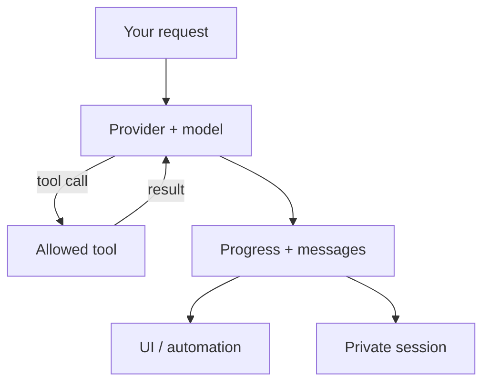
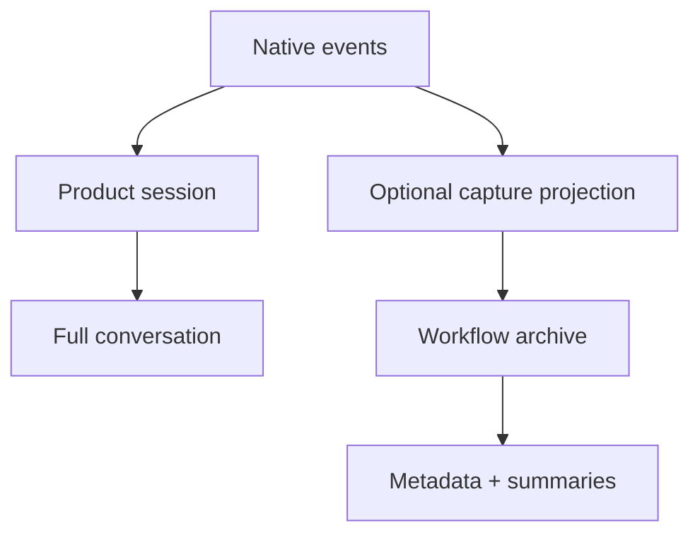

# How pipy works

Pipy runs a coding conversation in your workspace. You choose a provider and
model, send a request, and see the answer and any tool activity in the terminal.
Start with the [Quickstart](quickstart.md) for an offline smoke test or a
configured real model.

## From request to answer

The model may answer directly or ask for a tool. Pipy checks the tool call,
executes an allowed tool, and returns the result to the conversation. The loop
continues until the model finishes or you interrupt it. Tools can read and
change files or run shell commands in your workspace; review the
[tool and trust boundaries](usage.md) before working on sensitive projects.

Events carry progress, messages, and completed tool results to the terminal or
an [automation interface](automation-rpc.md). Providers differ in whether text
and thinking arrive incrementally or as a buffered answer; see the
[capability and evidence matrix](provider-capabilities.md). A tool call becomes
executable only when its arguments are complete and validated.

[Extensions](extension-api.md), [MCP servers](mcp.md), and
[Python codemode](codemode.md) add tools and workflows around the same product
conversation. The [architecture](architecture.md) and
[extension runtime map](extension-runtime.md) explain the implementation owners.

## Two stores with different purposes

The **product session** is the private, full-content conversation used by
resume, `/tree`, fork, compaction, and export. It can contain prompts, model
thinking, tool results, and command output. It normally lives outside the
repository under `~/.local/state/pipy/native-sessions/`. Use `--no-session` for
an ephemeral run; see [Sessions](sessions.md) for the path and controls.

The separate **workflow archive** supports metadata-first capture and learning.
Native capture projects allowlisted lifecycle metadata and counters rather than
copying the product transcript. Intentional workflow records can also contain
summary-safe decisions and review outcomes. The archive normally lives under
`~/.local/state/pipy/sessions/` and is inspected with `pipy-session`.
[Session Storage](session-storage.md) owns its exact privacy policy; raw external
capture requires a separate explicit decision. A summary-safe archive does not
make the full-content product session safe to publish.

## Choose your next step

- [Quickstart](quickstart.md): install, test without a model, then configure one.
- [Providers and models](providers.md): select a model and authenticate.
- [Sessions](sessions.md): continue or branch a product conversation.
- [JSON](json.md), [RPC](rpc.md), and [Python SDK](sdk.md): automate or embed pipy.
- [Workflow capture and sync](workflow-capture.md): manage the separate archive.
