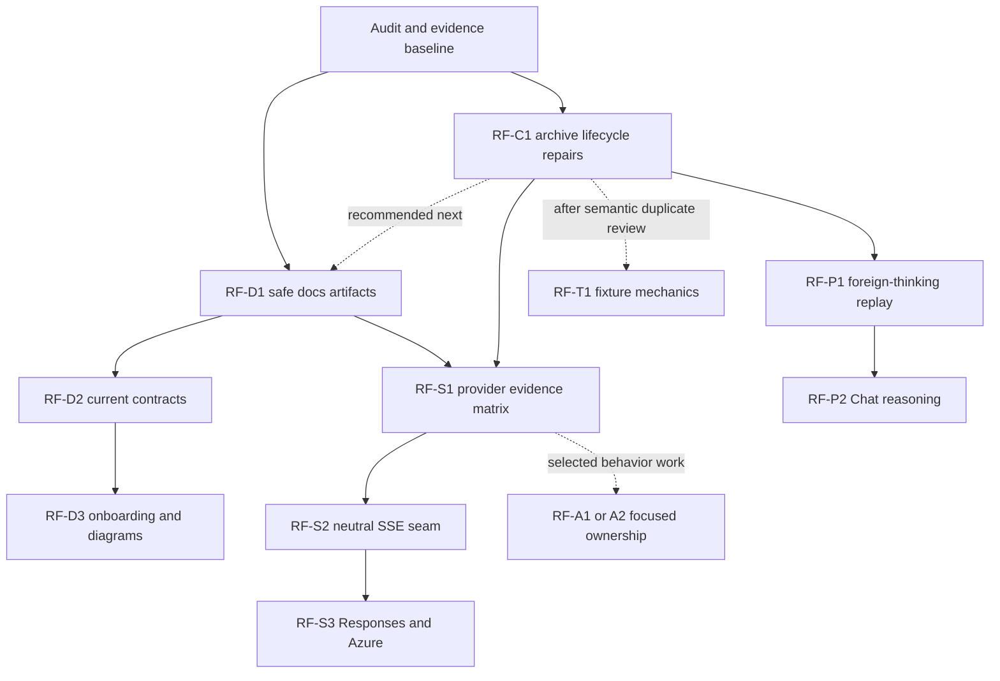

# Pipy quality audit and refactoring plan

Status: audited refactoring proposal, 2026-10-18. This is a bounded follow-on
program, not a reopening of completed MCP1, CM1, D0–D8, or UP2 work. The current
task index remains [backlog.md](../backlog.md).

## Scope and evidence

The audit considers runtime structure, implementation complexity and repetition,
correctness and security boundaries, provider streaming, tests, documentation,
and how clearly pipy explains its harness compared with tau. Findings below
separate observed behavior from design candidates and missing live evidence.
Source size is a reason to investigate ownership, not proof of a defect.

| Input | Baseline and method |
| --- | --- |
| pipy | `fe068d491eca2522f8de37ba8f6e5742c94476b0`, `main`; read-only scouts, source tracing, focused probes and coordinator validation |
| pi-mono | `c268154ca1171c2f9eefe75d3d7372a68aada2d5`, `/Users/jochen/src/pi-mono`; local pinned reference, not a claim about the current remote upstream |
| tau | `3bd42c0`, `/Users/jochen/src/tau`; source and documentation comparison; the requested `~/projects/tau` directory does not exist |
| slopscope | Clean checkout `28d3698d`; installed metadata says `0.1.0a1`, source says `0.3.0a1`; retain the exact commit with reports rather than treating the version label as authoritative |
| Session learning | Summary-safe `pipy-session search` and `list`; recent documentation setup/path-repair summaries confirm intentional Read the Docs publication; no raw transcripts inspected |
| Documentation build | A clean tracked `git archive HEAD docs zensical.toml` built in isolated scratch: exit 0, 303 HTML pages, no warnings |
| Visual assessment | Source and generated-artifact assessment only. CUA had no available browser, so desktop/mobile screenshots and rendered diagram inspection remain acceptance work |

Audit reports are local scratch evidence, not documentation dependencies or
publishable artifacts. Reproduce measurements from the pinned sources; do not
commit raw run logs, transcripts, or tool output to support this plan.

### Measurement interpretation

The slopscope composition report counts 902 Python files and 450,453 physical
lines: 365 source files / 164,051 lines and 491 Python test files / 268,382 lines.
It reports 3,279 duplicated source lines and 18,234 duplicated test lines at the
default 50-token threshold. Its size report marks 44 offenders: 39 functions,
one class and four test files, under limits of 150 / 1,500 / 3,000 lines.

These numbers describe the selected checkout and tool configuration. The size
report exited 0 while reporting `check_failed: true`; it was not an existing
failing CI gate, and no accepted size baseline exists yet. There is no validated
aggregate “slop score”. Duplication needs semantic inspection before extraction:
similar provider protocols or intentionally independent test oracles can require
similar code.

## Evidence register

| ID | Classification | Evidence and implication |
| --- | --- | --- |
| COR1 | Reproduced correctness defect | `src/pipy_session/recorder.py:165–166` opens an append descriptor without lifecycle serialization; `finalize_session:224–232` can rename and return before that descriptor writes. A synthetic barrier probe observed a finalized record change from one event to two after finalize returned, with no exceptions. This violates documented finalized-file immutability and can invalidate sync's immutable-file assumption. |
| COR2 | Reproduced correctness defect | `src/pipy_session/auto_capture.py:268–278` finalizes before unconditionally unlinking the mapping. A concurrent start can install a new active record/mapping after the rename, then the older stop deletes that replacement mapping. A synthetic barrier probe observed a surviving new active record and mapping disappear, without exceptions. |
| DOC1 | Verified local artifact defect | `zensical.toml:7–10` suppresses unresolved-reference warnings because ignored run bundles contain raw diffs, but does not exclude them. Existing local `site/` is 254 MB and includes `parity-loop/runs/*/*.log` and `run.jsonl`; only paths were inspected. The clean tracked build contains only `runs/.gitkeep`, so this is not evidence of a live hosted disclosure. `.readthedocs.yaml:16` copies all built files. |
| DOC2 | Verified stale current-facing claims | `architecture.md:17–27` names old next priorities and calls the repository private. `harness-spec.md:36–65,1515–1518` calls JSON/RPC planned and documentation local-only, contradicting shipped automation and Read the Docs configuration. Preserve historical rationale, but distinguish it from current contracts. |
| DOC3 | Readability candidate | `architecture.md` has 1,697 lines, `harness-spec.md` 4,312, `sdk.md` 1,294 and `extension-api.md` 2,929. The architecture Extensions section alone spans lines 302–986. `zensical.toml:11–34` mixes guides, reference, internals and archive utilities in a flat navigation list. |
| DOC4 | Onboarding candidate | `quickstart.md:46–71` asks the reader to run a useful repository task with the default fake provider before explaining the fake; authentication starts at line 73. README already leads with real-provider setup and is a useful model. |
| STR1 | Verified capability distinction | Ordinary provider construction reaches buffered `JsonHTTPClient.post_json` (`provider_construction.py:1217–1263`, `provider_turn.py:595–648,814–847`, `http.py:63–83`); `agent/loop.py:767–800` accepts the completed-message fallback. Codex alone has a specialized true-delta SSE path. A request-shape fake gate does not prove incremental or live provider behavior. |
| PAR1 | Verified existing parity difference | `native/providers/replay_content.py:79–92` turns foreign-model thinking into visible text; Pi `packages/ai/src/api/transform-messages.ts:122–136` drops it. Backlog already names this bounded replay candidate. Stored private history can remain unchanged while request projection is corrected. |
| PAR2 | Existing supported-model gap | Shared `providers/chat_completions_wire.py:236–258` extracts final text/tools without reasoning content; Pi's Chat adapter handles several reasoning fields and structured replay details. This is a protocol-fidelity candidate for affected models, not a demand to implement every Pi experimental surface. |
| ARC1 | Ownership candidate, no proven defect | `native/agent/provider_turn.py:752–1138` has a 387-line, 15-argument interruptible phase function with nested worker/retry state. `repl/provider_selection.py` has the 1,691-line `ProviderMutationEffects` class; `_compact_context` spans 226 lines. Select a cohesive behavior boundary rather than splitting by line count. |
| ARC2 | Ownership candidate, no proven defect | `repl/wiring.py` is 2,448 lines with two 200+ line composition functions; `tool_capabilities.py` is 1,965 lines and combines immutable selection values with live lock/publication ownership. Existing reload and capability invariants must survive extraction. |

The runtime architecture already has useful boundaries: the canonical agent
core is UI-free, coding-session policy sits above it, and product sessions and
the optional metadata-only workflow archive have distinct ownership. The
Mermaid map in [Architecture](../architecture.md#runtime-structure) describes
these boundaries. Refactoring should make them easier to follow and test.

The original god-file decomposition is complete: current `coding/session.py`
is 399 lines, `tui.py` is 570 and `TerminalUi` has nine fields, a 230-line span
and five methods. Current metrics report six unignored source C901 findings and
nine source type-ignore uses. These observations support targeted follow-ons,
not a repeat of the July architecture program or a rewrite of the synchronous
core. The July parity score and quality assessment remain historical evidence.

### Important missing capabilities compared with pinned Pi

The most visible omission is incremental output for ordinary real providers
(STR1). The next substantive provider issue is Chat-compatible reasoning and
replay fidelity (PAR2), alongside the already recorded foreign-thinking replay
change (PAR1). These affect ordinary established coding-agent use and deserve
priority over renderer polish. Buffered adapters still support cancellation;
absence of text deltas does not imply an uncancellable request.

The backlog also records narrower differences: RPC direct bash retains an
allowlisted executor; RPC `contextUsage`, auxiliary summary usage/usage entries
and some response metadata remain incomplete; resume lacks fuller
text/threaded/relevance search; grapheme-aware search editing, catalog refresh
and argument completion remain. Treat those as separate user-need decisions,
not prerequisites for every refactoring slice. The 17 catalog findings have a
bounded triage order in RF-P3.

Live Anthropic, xAI, Copilot, Bedrock and Google behavior and authenticated MCP
stdio/OAuth paths still lack credentials/evidence here. Fake-transport tests
remain useful evidence of a different kind. Their existence does not establish
live quality; missing credentials do not establish a runtime defect. Completed
MCP1 and CM1 status is compatible with these recorded evidence gaps.

The following remain intentional scope decisions: virtual models, classifiers,
image generation, durable execution, top-level parallel tool execution, and
MCP `models.*`. Python codemode intentionally differs from JavaScript and
already permits concurrent nested calls. The synchronous core and absence of
an MCP SDK dependency remain fixed direction. Package publishing/self-update
await an owned distribution identity. Do not turn these into automatic parity
requirements or add release automation as part of this quality program.

### Durable reproduction notes for COR1 and COR2

Use only a temporary archive root and synthetic summary-safe events. A barrier
must establish the interleaving; sleeps are not ordering evidence.

1. **Append/finalize:** initialize one record; pause append immediately after
   opening its append-mode descriptor and before writing. Finalize that same
   record and snapshot the returned file. Release the paused writer and compare
   bytes/event counts. The audit observed `before_events=1`, `after_events=2`,
   `changed=true`, `errors=[]`. A fixed implementation must serialize the
   accepted append before finalization or refuse a late append; after finalize
   returns, the finalized bytes must remain unchanged.
2. **Stop/start mapping:** start automatic capture for one platform-session
   identity; pause the older stop after recorder finalization but before mapping
   deletion. Start that same identity again so it creates a new active record
   and replacement mapping, then release the older stop. The audit observed
   `new_active_exists=true`, `mapping_before_release=true`,
   `mapping_after_release=false`, `errors=[]`. A fixed implementation must retain
   the replacement mapping and allow an event to reach its new active record.

Turn these into deterministic regressions during implementation, covering
thread and process entry points and failure cleanup. The notes preserve the
defect and expected invariant without depending on temporary probe scripts.

## Architecture comparison with pinned Pi

Paths below are relative to each repository; pipy paths omit
`src/pipy_harness/`. The comparison concerns ownership, not an instruction to
copy TypeScript packaging or async execution into Python.

| Boundary | Pi | Pipy and implication |
| --- | --- | --- |
| Provider APIs | `packages/ai/src/index.ts:4–19,33–44` exports model/content/auth/provider APIs. | `native/provider.py:132–160` and the catalog/construction modules provide the provider boundary. Keep protocol translation with provider owners; use RF-S1 to expose the important streaming/evidence differences. |
| Reusable agent | `packages/agent/src/agent.ts:188` and `agent-loop.ts:102–163` place the reusable agent below the coding app. | `native/agent/loop.py:407,488` provides the corresponding UI-free loop. Preserve this already implemented separation rather than reopening the completed decomposition. |
| Product coordination | `packages/coding-agent/src/core/agent-session.ts:379,512,1104,2058` coordinates product-session behavior. | `native/coding/session_controller.py:900,1079`, state/store owners and `native/repl/wiring.py` separate policy, persistence and composition. RF-A2 should clarify one owner at a time, not collapse them into a new central session class. |
| Execution and event delivery | `packages/agent/src/agent.ts:371–384` exposes Promise-based prompt/continue; listeners are awaited at `:256–266,609–610`. | `native/agent/loop.py:488`, `agent/ports.py:11–19` and `agent_adapters.py:45–55` use synchronous loop/sink/composite delivery, with owned workers for I/O and cancellation. This is an intentional runtime difference; no asyncio migration follows from the comparison. |
| Frontend boundary | `packages/coding-agent/src/modes/interactive/interactive-mode.ts:3402–3408` handles agent events in InteractiveMode. | `native/ui/state.py:202,219–245` reduces events into UI state, `automation/agent_events.py:70–84` projects automation events, and the TUI facade stays outside the core. Preserve these shared event contracts while improving provider output. |

## Tau comparison and documentation direction

Tau's README explains `tau_coding → tau_agent → tau_ai` and
`AgentHarness / CodingSession / TUI` in lines 27–57. Its architecture overview
introduces those packages before implementation detail, and its agent-loop
page explains seven concrete turn steps before listing events. Its concepts
page introduces providers, tools, sessions, instructions and context with
links to the corresponding guides.

The comparable source locations are `website/content/internals/architecture.md`
lines 6–35 and 61–81, `internals/agent-loop.md:10–23`, and
`website/content/concepts.md:10–75`. `website/data/sidebar.yaml:3–58` groups
Use Tau, Guides, Reference and How Tau works. `Home.astro:41–129` contains a
clear product/teaching proposition and a prompt/model/tool/result SVG diagram;
`Docs.astro:16–79` supplies grouped navigation, descriptions, edit links and
previous/next reading. `website/tests/site.test.mjs:19–96` checks built routes,
links, anchors, callouts and navigation.

Pipy should adopt that progressive explanation and artifact validation where
useful. This does not require an Astro migration or tau's three-package layout.
Tau itself retains phase-history detail in its architecture overview, so it is
a comparison with specific strengths, not a universal target. No rendered
visual superiority is claimed from these source observations.

## Delivery rules

Work directly on `main`, with one writer in the shared checkout. Read-only
investigators may run concurrently. Commit one bounded, validated slice before
starting the next. Do not create topic branches for this program.

For implementation slices, run focused regression tests, `just check`, `prek`
when configured, and a fresh independent review under the repository review
policy. Terminal changes also need the real-PTY checks. Documentation changes
need `just docs-build` and link/anchor checks; run rendered desktop/mobile QA
when presentation changes. Keep user docs, topic contracts and release notes
with behavioral changes. This planning-only change needs no release note
because it changes neither runtime behavior nor a supported user workflow.

## Ordered slices

P1 means a confirmed correctness or artifact-boundary repair comes first. P2
means a valuable capability or maintainability slice follows that repair.
Optional extractions are selected only when their behavior is being changed.

### RF-C1 — Serialize archive lifecycle and capture identity ownership

**Status:** complete, 2026-10-18. The recorder and capture transitions form one
cohesive slice. Focused regressions, full `just check`, tracked documentation
build and link checks passed; independent high-effort review closed CLEAN after
repairing generated-identity admission and exactly-once cleanup ownership.
**Priority:** P1, first implementation work. **Depends on:** none.
**Evidence:** COR1, COR2.

**Files:** `src/pipy_session/recorder.py`, `src/pipy_session/auto_capture.py`,
their focused tests, `docs/session-storage.md`, workflow capture guidance and
release notes.

Before code changes, revise the written lifecycle contract: identify the
record/identity serialization owners, all participating readers/writers,
thread/process behavior, lock ordering, reentrancy and failure cleanup. A guard
used by only some callers does not satisfy this contract. Finalization must
wait for admitted writes, prevent later writes and preserve immutable final
bytes. Stop must retire only its own capture mapping; it must not delete a new
generation installed by start. Preserve documented append/finalize behavior
without turning the optional archive into a new database or daemon.

Implement and review the recorder boundary first, then the capture-identity
transition against that contract as a separate small green increment if needed.

**Accept when:** both barrier regressions above pass through supported entry
points; late appends cannot mutate or recreate finalized records; concurrent
start/stop retains the current generation; interrupted failures release owners
and leave documented recoverable state. Run focused recorder/capture/sync tests,
full checks and independent review. Repeated shared-state findings require a
contract revision before further implementation, as required by `AGENTS.md`.

### RF-D1 — Exclude scratch artifacts from documentation output

**Status:** complete, 2026-10-18. The build/preview wrapper stages all current
documentation except the reserved scratch directories. Artifact/search,
strict-link, preview reload and interrupted-publication regressions, full
`just check`, canonical documentation build and rendered link/anchor checks
passed. Independent high-effort re-review closed CLEAN after fixing the
publication interruption window.

**Priority:** P1. **Depends on:** none. **Evidence:** DOC1.

**Files:** `zensical.toml`, docs build/hosting validation, relevant documentation
tests and documentation tooling guidance.

Add explicit exclusions for ignored parity-loop run bundles and local audit
artifacts. Prove exclusion with harmless sentinels in an isolated fixture. Keep
legitimate documentation link checking; narrow or remove the global unresolved
reference suppression when scratch content no longer enters the build.

**Accept when:** neither output files nor the search index contain scratch
sentinels; clean tracked and populated-local-input builds produce the same
publishable documentation set; documentation links still validate. No raw
artifact contents need inspection. Run focused build-artifact checks and the
documentation build.

### RF-D2 — Separate current contracts from implementation history

**Status:** RF-D2a current-status repairs complete, 2026-10-18. This first slice
corrects public/native-runtime/hosted-doc claims while retaining existing
headings, anchors and contract owners. Focused tests, full `just check`, strict
documentation build and rendered link/heading checks passed; independent
high-effort review and scoped historical-quote re-review closed CLEAN.
RF-D2b topic extractions follow the provider slices; the full RF-D2 program is
not complete.

**Priority:** P2. **Depends on:** RF-D1. **Evidence:** DOC2, DOC3.

**Files:** `docs/architecture.md`, `docs/harness-spec.md`, `docs/sdk.md`,
`docs/extension-api.md`, `docs/user-documentation.md`, `zensical.toml`, and
focused topic or history pages introduced by the slice.

First repair public/current-runtime/hosted-doc contradictions. Then extract
one topic at a time into a current ownership contract and dated implementation
evidence. Start with the architecture overview and its extension-history block;
do not move four large documents wholesale in one commit. Keep public links and
anchors working, and ensure each invariant has one current owner.

**Accept when:** the overview describes current ownership and dependency
direction without requiring knowledge of old slice IDs; retained history is
dated; SDK usage examples precede implementation contracts; internal links and
anchors pass. Use a small first docs slice for the contradictions, followed by
separate reviewed topic extractions if needed.

### RF-D3 — Explain the harness through a first useful session

**Priority:** P2. **Depends on:** RF-D1 and the first RF-D2 overview slice.
**Evidence:** DOC3, DOC4 and the tau comparison.

**Files:** README, `docs/index.md`, `docs/quickstart.md`, a concepts/agent-loop
explanation, focused architecture diagrams and `zensical.toml`.

Group navigation by audience. Introduce the prompt → provider → tool → event →
session flow and the separate product/workflow storage domains before naming
implementation classes. Offer clearly labeled offline smoke and real-provider
paths; real setup must select a provider/model before the first useful request.
Use the current Zensical stack unless a concrete limitation justifies more.

**Accept when:** each setup path is copyable and explicit about whether a model
is contacted; a reader can locate guides, reference and internals independently;
diagrams match actual ownership; visual QA covers desktop/mobile navigation,
diagram legibility, code overflow and keyboard access. Any native screenshot
uses isolated state with the `pi` theme. Build and link checks pass.

The existing runtime, lifecycle and privacy Mermaid diagrams are useful to
maintainers; the gap is a short explanatory path through them. Prefer the two
focused agent-loop/storage diagrams above to more decorative graphics. Render
them before judging whether their information density and presentation work.

### RF-S1 — Publish a provider capability and evidence matrix

**Status:** complete, 2026-10-18. The API-family inventory links deterministic
transport, request-shape and dated DF1 live evidence without broadening live
claims. Real local SSE/WebSocket barriers pin text/thinking callbacks before
terminal data; the ordinary JSON regression retains buffered completion.
Focused/full checks, strict documentation build and rendered links passed;
independent high-effort first review closed CLEAN with no findings.

**Priority:** P2. **Depends on:** RF-C1 and RF-D1.
**Evidence:** STR1.

**Files:** provider documentation/catalog, provider adapter tests and the
provider evidence index.

Distinguish buffered completion, true incremental deltas, cancellation,
transport, request-shape conformance and authenticated live evidence for each
provider family. Retain intentional completion fallback. Clarify that an
end-to-end fake request gate exercises the adapter path without proving live
streaming behavior.

**Accept when:** every claimed streaming capability maps to an incremental
transport test, and every live claim maps to dated live evidence. Missing
credentials remain explicit evidence gaps, not inferred defects.

### RF-P1 — Correct foreign-model thinking request projection

**Status:** complete, 2026-10-18. Shared projection follows pinned Pi
`c268154ca` / `911309429`: foreign thinking is omitted rather than converted to
text. Exact provider/API/model replay retains its existing signed, redacted,
empty encrypted and nonblank unsigned blocks; history and tool correlation
ownership are unchanged. Focused replay/SDK reopen regressions, full `just check`
(12,562 passed, two skipped), strict docs and rendered links passed. Independent
high-effort review closed CLEAN after synchronizing current source comments.
RF-S2 is the next provider slice.

**Priority:** P2, small. **Depends on:** RF-C1; serialize shared provider/docs
edits with RF-S1. **Evidence:** PAR1.

**Files:** `native/providers/replay_content.py`, focused reasoning/cross-provider
request tests, provider/session documentation and release notes.

Drop foreign-model thinking from provider requests according to pinned Pi's
current contract. Preserve private stored history, same-model signed/redacted
thinking, tool-call identity and existing foreign-signature cleanup.

**Accept when:** API/provider/model mismatches drop thinking; exact same-model
replay retains required signed/redacted blocks; original history is immutable;
resume and model-switch request fixtures pass. No session-schema migration or
agent-loop change is needed.

### RF-S2 — Extract a neutral cancellable SSE transport seam

**Status:** complete, 2026-10-18. Focused transport/Codex tests, full `just check`
(12,584 passed, two skipped), strict documentation build and rendered links
passed. Independent high-effort first review closed CLEAN; its source-owner
inventory correction is reflected in the harness specification. The shared
payload stream owns response closure even before its first read; Codex retains
event/error/authentication/WebSocket/retry policy. Ordinary Responses/Azure
remain buffered for RF-S3.

**Priority:** P2. **Depends on:** RF-S1.

**Files:** specialized Codex streaming transport, shared HTTP/cancellation
boundary and focused transport tests.

Extract only the provider-neutral byte/event parsing and cancellation behavior
needed by another SSE family. Keep Codex authentication, WebSocket behavior,
reconnect/retry policy and provider event interpretation with their owners.

**Accept when:** Codex behavior remains covered; fragmented SSE frames,
cancellation, error closure and resource cleanup have transport-level tests;
no second lifecycle owner or general event framework is introduced.

### RF-CI1 — Synchronize product PTY test process exit

**Status:** complete, 2026-10-18. Focused checks passed on Python 3.14.8 and
isolated Python 3.11.13; independent high-effort first review closed CLEAN.
Full `just check` passed (12,590 tests, two skipped), with strict documentation
build and rendered links checked. RF-S3 follows this CI stabilization.

The Python 3.11 CI failure after RF-P1 exposed an existing test-only race:
product PTY EOF/EIO can precede process exit becoming observable. The neighboring
selector already waits through the original deadline; the product helper now
uses the same remaining-deadline semantics, kills only on `TimeoutExpired`, and
closes its PTY descriptors on every exit. Deterministic EOF/EIO/timeout and
unexpected-failure regressions exercise the helper used by the real product
test. Its warning, exit-status and private-session assertions are preserved.
This stabilization changes no runtime behavior, CI configuration, retry policy
or timeout bounds and needs no public behavior release note.

### RF-CI2 — Drain RPC signal-test output during shutdown

**Status:** complete, 2026-10-18. Focused signal checks passed on current Python
and isolated Python 3.11; independent high-effort first review closed CLEAN.
Full `just check` passed (12,635 tests, two skipped), with strict documentation
build and rendered links checked. RF-S3b follows this CI stabilization.

The diagnosis of [CI run 39120239367](https://github.com/ephes/pipy/actions/runs/39120239367)
identified a test-only wait-before-read cycle: the RPC signal test stopped
consuming stdout after its follow-up acknowledgement, then waited for process
exit while a worker could be blocked flushing shutdown JSONL. The test now hands
stdout to one concurrent reader before signalling/waiting, with bounded reader
join/error reporting and child kill/reap before failed-test IO cleanup. Its
20-second process wait, exit-143, MCP termination and discarded-follow-up
assertions are preserved. The same actual subprocess scenario runs with PIPE
and locally bounded socketpair output; the captured remainder must exceed the
effective send buffer. Restoring the old order fails the bounded case. Reduced
remote pipe capacity is an inferred trigger: the runner's actual capacity was
not measured. No runtime, CI configuration, timeout or retry policy changes, and
no public behavior release note, belong to this stabilization.

### RF-C2 — Retain input ownership across Codemode activity handoffs

**Status:** complete, 2026-10-18. Required-runtime and terminal/nested focused
checks passed (659 tests), with a final owned PTY/composite pass (63 tests).
Independent high-effort review closed CLEAN with no criticals or warnings;
its one changelog-order suggestion was applied. Full `just check` passed
(12,669 tests, two skipped), together with strict docs and rendered links.
The next selected reasoning-fidelity slice remains RF-P2.

The builtin product Codemode runner receives a neutral, optional input-context
factory from TTY composition. One owner spans `execute`/`_run` through executable
cleanup, so nested read/computation handoffs do not trigger another depth-zero
flush. The existing session-thread waiter remains the sole reader. Later
canonical parent hooks, extension composites and arbitrary callback preemption
are outside this scope. Startup/outer `TCSAFLUSH`, paste decoding and explicit
foreign-I/O suspend/resume policy remain unchanged.

The [CI run 39124798560](https://github.com/ephes/pipy/actions/runs/39124798560)
reported missing abort/readiness output; its truncated log alone does not prove
the cause. A separate local single-Escape barrier, before the inner acquisition
after a settled read and independent of raw depth, proves the old binding loses
the key. The fixed path must also reap workers, allow a fresh successful turn
and replay durable results without duplicate execution. Coupled PTY failure
cleanup preserves the original assertion instead of masking it with a normal
exit wait. No CI timeout/retry/configuration changes belong to this slice.

### RF-S3 — Add incremental OpenAI Responses and Azure streaming

**Status:** RF-S3a ordinary Responses complete, 2026-10-18. Full `just check`
passed (12,634 tests, two skipped), with focused wire/mode and PTY regressions,
strict docs and rendered links. Fresh independent high-effort review closed
CLEAN after fixing sink-error retry classification, status-body cancellation
and callback-cancellation partial retention. Default catalog/direct construction streams
through the RF-S2 seam; explicit JSON injection preserves buffered request
bytes. The shared Responses consumer retains ordered final content, usage,
signatures and non-executable partial history, with an additive assembler
completion check that does not change Codex policy. Local default-construction
fixtures cover OpenAI, xAI, Copilot and custom Responses protocol/auth fields,
pre-terminal callbacks, terminal closure, JSON/RPC and real PTY behavior, errors,
cancellation and canonical managed retries. No new authenticated live evidence
is claimed.

**RF-S3b status:** complete, 2026-10-18. Fresh independent high-effort first
review closed CLEAN; full `just check` passed (12,659 tests, two skipped).
Default Azure catalog/direct construction uses the existing shared consumer;
explicit JSON injection retains
the original request bytes and buffered behavior. Azure retains configuration
preflight, base URL/deployment/API-version/auth precedence, cache/reasoning,
usage, API provenance and replay ownership. Local fixtures cover the three
built-in rows and custom Azure routing, pre-terminal callbacks, terminal
closure, ordered tool/usage/signature replay, cancellation and managed retries,
with default JSON/RPC and real PTY composition. Shared protocol/Codex policy is
unchanged, and authenticated live evidence remains separate.

**Priority:** P2. **Depends on:** RF-S2.

**Files:** OpenAI Responses/Azure adapters, provider construction and focused
incremental transport/agent tests, capability documentation and release notes.

Implement one provider family at a time over the neutral seam, preserving
request history, usage and tool-call identity. OpenAI Responses/Azure are the
first proposed family; do not expand into every buffered adapter in this slice.

**Accept when:** the first visible text/reasoning delta arrives before response EOF,
cancel closes the stream promptly, final messages and usage remain authoritative,
and buffered fallback still has an explicit test. Separate deterministic tests
from authenticated live smoke evidence.

Final ordered content, usage, tool identity and partial-output failure behavior
must agree with the deltas; do not emit duplicate completion text or late output
after cancellation. Exercise the catalog-selected adapter through TUI and
JSON/RPC using a local fixture server, including before-first-event and
after-first-event retry boundaries. Run provider/agent tests and PTY checks.

Tool calls remain final-message values in this bounded slice. The current
provider port exposes text/reasoning sinks, and canonical tool-execution events
begin after provider completion. Test tool-only responses and retention of the
final tool-call/result or failure shape, but do not promise partial tool-argument
deltas. Adding those requires a separately selected event-schema and UI/JSON/RPC
projection change; RF-S1 must mark that capability separately.

### RF-P2 — Restore Chat-compatible reasoning fidelity

**Priority:** P2. **Depends on:** RF-P1. **Evidence:** PAR2.

**Files:** shared Chat wire translation, compatible adapters and compatibility
metadata, reasoning/replay tests, provider documentation and release notes.

Compare a finite set of reasoning fields and structured details against pinned
Pi, then preserve display content and signed replay metadata separately. Decide
from source/request fixtures whether current Mistral Conversations behavior is
one compatible slice or a separate adapter change. Do not silently claim Chat
streaming as part of final-message reasoning support.

**Accept when:** reasoning-only and mixed text/tool/thinking responses survive
same-model continuation and resume; foreign-model switches follow RF-P1;
unsupported variants are explicit. Provider-neutral ordered content remains
authoritative.

### RF-A1 — Extract provider-attempt state when extending execution phases

**Priority:** optional after RF-S1; select before a change that extends the
interruptible phase protocol. **Evidence:** ARC1.

**Files:** `native/agent/provider_turn.py`, provider-turn/retry/partial-output
tests and the focused executor contract.

Evaluate one per-attempt owner for worker result/error/prepared/partial state
and retry-lease transitions. Keep completion-versus-cancel arbitration, output
gate closure and callback ownership explicit. Do not add a generic framework
or move synchronization behind several shallow wrappers.

**Accept when:** the extracted owner has a concrete cohesive responsibility;
retry, cancellation, partial output, automation and shutdown contracts remain
unchanged; no caller bypasses the state guard. The audit proved no defect here,
so a size reduction alone is insufficient justification.

### RF-A2 — Extract one cohesive product composition boundary

**Priority:** optional, one sub-slice at a time. **Depends on:** a selected
behavior change touching that owner. **Evidence:** ARC1, ARC2.

**Files:** `native/repl/wiring.py`, `native/repl/provider_selection.py`,
`native/tool_capabilities.py` and focused ownership/gate tests.

Select one candidate: MCP presentation/readiness assembly with explicit inputs;
one provider-mutation effect family; or pure immutable capability-selection
transitions. Keep startup/shutdown sequencing with one composition owner,
provider/auth mutation ordering with one live owner, and capability
read/validate/replace under its current shared mutex. Preserve current-manager
lookup across reload. Do not split all three areas in the same slice.

**Accept when:** dependency direction is simpler and observable lifecycle order
is unchanged; reload, model/auth mutation, MCP session/switch/command tests and
capability race tests relevant to the selected boundary pass. Avoid importing
private phase types into new modules simply to meet a file ceiling.

### RF-T1 — Consolidate fixture mechanics without merging test oracles

**Priority:** optional P2. **Depends on:** semantic duplicate-cluster review.

**Files:** selected `*_fixtures.py` helpers and the tests that use them.

Extract repeated fixture I/O/setup mechanics only where ownership and failure
diagnostics become clearer. Source/test exported-API expected lists and
provider-specific golden request assertions are deliberately independent
oracles; preserve that independence. A 605-line largely declarative CLI parser
or occurrences of “compat” are not automatic refactoring work.

**Accept when:** a representative duplicated cluster has one fixture owner;
provider-specific expectations remain explicit; fixture failures still identify
the provider and assertion; test independence is not replaced by importing the
implementation's own expected values. No repository-wide test rewrite.

### RF-P3 — Triage the 17 catalog findings individually

**Priority:** existing bounded maintenance candidate, after correctness work.
**Depends on:** fresh pinned catalog inputs; serialize catalog/docs edits.

**Files:** provider catalog generation/runtime metadata, conformance fixtures,
catalog documentation and release notes for adopted changes.

Give each drift a source/runtime/impact decision. Prices/context limits need
metadata fixtures; effort flags must match adapter behavior; a new provider row
needs auth/construction/default/selection evidence. Do not bulk-replace catalog
values or allowlist every difference.

**Accept when:** adopted rows have specific behavior evidence and unresolved
rows remain visible with source SHA/date and an explicit impact decision.
Catalog freshness/input checks and relevant provider comparison checks pass.
The drift command returns nonzero while unallowlisted differences remain;
record and reconcile that dated result as intentional deferred drift rather
than promising a green drift gate or adding a blanket allowlist.

## Scheduling and decision boundaries

Solid arrows show prerequisites; the dashed archive-to-docs arrow records the
recommended repair order, while other dashed arrows mark optional follow-ons.
The graph does not authorize concurrent writers. Complete one slice before
selecting another. Architecture complexity and duplication
candidates require ownership and correctness findings from the full audit
before they become implementation work orders.

Recommended waves are: (1) RF-C1 then RF-D1; (2) RF-S1, the first small RF-D2
current-status repair, and RF-P1; (3) RF-S2/RF-S3, then RF-P2 and the selected
RF-D2/RF-D3 explanation work; (4) optional ownership/fixture extractions and
bounded catalog maintenance according to the next user need. The independent
work orders still run serially through one writer. A new confirmed defect
changes this order; a large metric alone does not.

Catalog drift, foreign-model thinking replay, missing provider credentials and
live MCP/OAuth evidence retain their existing backlog owners. They do not become
refactoring regressions merely because this audit records them. Preserve the
completed status and accepted boundaries of MCP1, CM1 and UP2.

## Selection boundary

RF-C1 is the recommended next implementation slice. This audit changes no
runtime code and does not resolve either reproduced race. Select and validate
one work order at a time; evidence or behavior changes may alter later
priorities. A completed audit is not a claim that every proposed extraction
must be performed.

## Validation and review evidence

- The focused architecture/provider/replay audit checks passed: 60 tests.
- Focused recorder/capture checks passed: 50 tests. The barrier probes above
  expose interleavings those existing tests do not cover.
- Clean tracked documentation build passed with 303 HTML pages and no issues;
  the populated local artifact path listing established DOC1 independently.
- The final tracked-plus-working documentation overlay, including this new
  plan, built 304 HTML pages with no issues; 206 local generated link/asset
  targets and anchors from the plan/backlog pages resolved without failures.
- The isolated tracked-copy baseline reported 12,526 passed, two skipped and
  one failed in 814.85 seconds. The sole failure was
  `tests/test_parity_lessons.py::test_real_repo_ledger_is_valid`: that copy had
  no `.git`, so 119 historical commit IDs could not resolve. The exact test
  rerun read-only in the real repository, with bytecode/cache writes disabled,
  passed (one test, 2.47 seconds). Lint, format and mypy checks passed. This is
  split validation evidence, not a claim that a literal `just check` run in
  the real checkout completed green.
- An independent `gpt-6.1-sol`/high planning review found two material scope
  issues: a drift-gate acceptance contradiction and an unsupported promise of
  partial tool streaming. Both were repaired; the focused follow-up found no
  further material findings. This owner-requested same-family planning review
  is independent context, not different-family commit-gate evidence.

This reconnaissance has two reproduced archive correctness defects and a
verified local documentation-artifact boundary risk. It does not establish a
public leak or certify the repository free of security defects. No production
credentials, raw transcripts or run-log bodies were inspected for the probes.
Security reconnaissance selectively inspected auth persistence, MCP refresh
locking, OAuth, tool capabilities, and metadata-capture redaction/lifecycle.
It did not include a dependency-advisory/CVE audit, fuzzing, authenticated
provider integration or a penetration test. Intentional shell, extension and
codemode execution is a product capability, not by itself a security finding.
A suspected refresh-lock issue was disproven by its inode guard and is not
carried as a defect.
